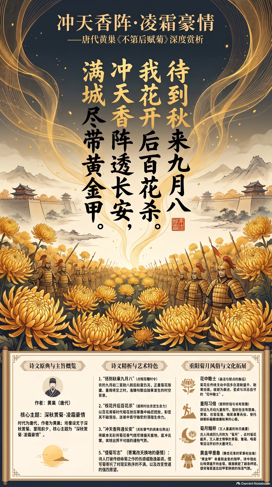

**唐代·黄巢** · 深秋赏菊，重阳前夕的凌霜豪情

## 诗词全文

待到秋来九月八，
我花开后百花杀。
冲天香阵透长安，
满城尽带黄金甲。

## 赏析

农历九月初二，秋意已深，正是菊花渐盛、重阳将近的时节。黄巢这首咏菊诗没有停留在寻常的惜秋赏花，而是把菊花写成了傲霜而立、蓄势待发的英雄形象。“待到秋来九月八”点明花期与时令；“我花开后百花杀”以强烈对比突出菊花在百花凋零时独自灿烂的生命力。“冲天香阵”将无形的香气写得铺天盖地，气势极盛；末句“满城尽带黄金甲”尤为传神，既写菊花金黄繁密、遍布城中的壮观，也使花瓣仿佛将士铠甲，呈现出威武肃杀的画面。诗人借菊明志，寄寓了对现实秩序的不满和改变世道的强烈愿望。今天读来，既能感受深秋的绚烂，也能体会逆境中不随流俗、坚守锋芒的精神。

## 相关风俗

- 菊花在传统文化中常被视为“花中隐士”，因其多在深秋开放、能耐寒霜，象征高洁、坚贞与淡泊自守。
- 农历九月初九为重阳节，民间有登高、赏菊、饮菊花酒、佩茱萸等习俗，寄托避邪祈福与长寿安康之愿。
- 古人常把农历九月称作“菊月”。此时菊花盛开，文人雅士会举行赏菊、簪菊、咏菊等活动，留下大量诗文画作。
- “黄金甲”本指金色铠甲，诗中以此比喻满城黄菊，既抓住菊花色泽，也使静态花景具有军阵般的磅礴气势。

## 背后的故事

> 这首诗最耐人寻味处，在于它虽题作“落第后”之作，现存可靠材料却没有记录黄巢究竟在哪一年、哪一次考试失意后写成。诗中菊花的“黄金甲”本是深秋盛放的夸张写法；黄巢后来攻入长安、建立“大齐”，使这首诗在后世读来仿佛早已把个人不平与乱世野心一并预言。

### 作者轶事

- 黄巢是曹州冤句人，史传所写的他并非纯粹舞文弄墨的寒士：他“善击剑骑射，稍通书记，辩给，喜养亡命”。这几笔勾勒出一个能文、尚武、又善结纳亡命者的边缘豪强形象。读“冲天”“黄金甲”时，不妨把它看作此种尚武性格在诗里的先声，而不只是书斋中的咏物。 〔史实 · 《旧唐书·卷二百下·黄巢传》〕
- 黄巢后来由盐贩、亡命之徒的首领，卷入王仙芝起事，并逐渐成为唐末最强的叛军领袖。史书叙其转战中原、南下岭表，再北返攻破潼关；他的人生轨迹使“百花杀”的猛烈措辞格外容易被后人政治化。不过，不能反过来据此断定此诗必作于起兵前的某一确年。 〔史实 · 《新唐书·卷二百二十五下·黄巢传》〕

### 本事与创作背景

- “不第后赋菊”这一题目直接把诗意安放在科场挫折之后：菊花不与春花争时，偏在霜秋独盛，正适合寄托失意者的自我期许。但现存诗集只保存题目与正文，没有黄巢自序、酬答对象或唱和记录；“落第”是传统题解，不能细化为某年进士试、某位主考官所致。 〔史实 · 《全唐诗·卷七百三十三》〕
- 后世常将“满城尽带黄金甲”视为黄巢攻占长安的预言。事实上，黄巢入长安、建号“大齐”是在广明元年末至中和元年初的政治事件，而诗的写作时间并无同时材料可证。较稳妥的读法是：后来发生的兵乱为菊花诗增添了“甲兵满城”的回声，而非史料已经证明诗人当初预写了战事。 〔史实 · 《资治通鉴·卷二百五十四》〕

### 时代背景

- 黄巢活动的乾符、广明间，唐廷藩镇坐大，财政困窘，镇压民变的军队亦常缺饷失纪。王仙芝、黄巢起兵后，朝廷屡遣诸镇兵围剿，彼此观望掣肘。诗里由“我花”对“百花”的绝对性口吻，放进这种旧秩序摇晃的年代，便不只是个人傲岸，也暗合草泽豪强挑战朝廷权威的时代心理。 〔史实 · 《资治通鉴·卷二百五十二》〕
- 盐是唐代专卖和征税的重要财源，贩私盐者往往既逐利又与地方武装相连。黄巢本人与盐贩身份相联系，故其起事并非单纯“文人落第”的浪漫故事，而有晚唐赋役、盐法与地方失序的现实底色。将诗只解释成科举怨气，会遮蔽它所来自的社会边缘力量。 〔史实 · 《旧唐书·卷二百下·黄巢传》〕

### 风土人情

- 农历九月九日为重阳。南朝以来的岁时记已记载此日人们结伴郊饮、佩茱萸、食蓬饵，并饮菊花酒；唐人又常有登高宴集的习俗。诗写“九月八”，正是重阳前一日：菊意已浓，节日尚未来临。它不像闲适宴游，反而把节前本应明丽的花事写成一场蓄势待发的秋日检阅。 〔史实 · 《荆楚岁时记·九月九日》〕
- 菊在传统药食与观赏文化中兼具双重身份：可入酒、入枕，也因耐霜晚放而被赋予延年、守节之意。此诗不写采菊、饮菊酒的清雅细节，却用“香阵”写成弥漫全城的气势；“黄金甲”则把黄菊密集铺展的视觉感，转化为军阵铠甲的金属光泽。 〔史实 · 《本草纲目·卷十五·草部·菊》〕

### 典故与名物

- “我花”通常即指菊花，并非另有一种名为“我花”的植物。“百花杀”中的“杀”宜先按凋零、衰败理解：百卉多在春夏盛开，至深秋而尽，菊却正逢花期。诗人故意把自然的季节更替写得像一次清场，才使随后“冲天”“满城”的政治性夸张显得格外凌厉。 〔史实 · 《全唐诗·卷七百三十三》〕
- “黄金甲”不是必须坐实为某一则古典故事的典故，更像即景造语：黄菊连片盛放，花瓣与枝叶密集，远观有如金甲覆地；“甲”又自然唤起武备。正因这种花与兵的双关，后人特别爱把它同黄巢占领长安相连。考释时应保留其修辞开放性，不宜硬指为史实预兆。 〔史实 · 《全唐诗·卷七百三十三》〕
