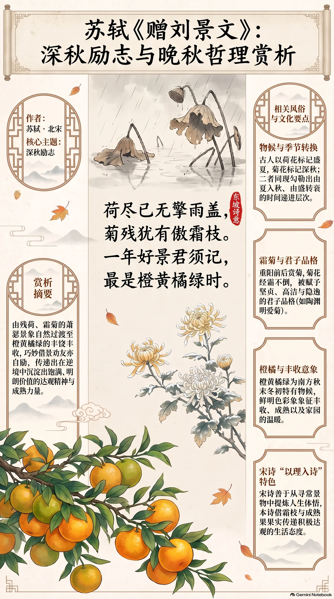

**北宋·苏轼** · 深秋励志

## 诗词全文

荷尽已无擎雨盖，
菊残犹有傲霜枝。
一年好景君须记，
最是橙黄橘绿时。

## 赏析

这首诗写在深秋将尽之时，却没有停留于荷叶凋零、菊花残败的萧瑟感伤。前两句先以“荷尽”“菊残”点出时令：夏日荷叶不再如伞盖般擎雨，秋菊也渐近残谢；但一个“犹”字笔锋转起，突出菊枝经霜而不屈的精神。后两句更将目光投向橙黄橘绿的丰收景象，指出一年中最值得珍惜的好时节，恰在这色彩饱满、果实成熟的晚秋。苏轼借景劝友，也自励自勉：人生即使到了看似衰飒的阶段，仍可能沉淀出最丰厚、最明朗的价值。诗歌语言浅近，构思却富有层次，从凋零写到坚韧，从萧瑟转向丰饶，体现了宋诗善于从日常景物中发掘哲理的特色。

## 相关风俗

- 古人常以荷花、菊花标记季节转换：荷多属盛夏，菊则是深秋代表。二者同现于诗中，形成由夏入秋、由盛转衰的时间层次。
- 重阳前后正是赏菊时节。菊花能经受秋霜，传统文化中常被赋予坚贞、高洁与隐逸的品格，陶渊明尤以爱菊闻名。
- 橙黄橘绿是江南及南方秋末冬初常见的物候景象。柑橘成熟时颜色鲜明，古人常以此象征丰收、成熟和家园的温暖。
- 宋代诗歌重视“以理入诗”，常从寻常景物中提炼人生体悟。本诗不直说劝勉，而借霜枝与果实表达积极达观的生活态度。

## 背后的故事

> 这首小诗最耐人寻味处，不在一般的“秋景励志”，而在赠诗对象刘景文的身世：他是西夏战场上殉难将领刘平之子，年逾花甲仍久困不遇。苏轼在杭州任上曾专门上状荐举他；“菊残犹有傲霜枝”与“橙黄橘绿”，便不只是写景，也是给一位老将的迟暮鼓励。

### 作者轶事

- 苏轼到杭州并非单作风雅太守。元祐四年出知杭州后，他面对的是湖港淤塞、漕运与市民用水等实务，次年发动疏浚西湖，筑堤以利交通。因而《赠刘景文》中看似清疏的荷、菊、橙、橘，也可放回一位长期奔走于地方政务的太守视野：他看见的秋色，带着城市与田园相接的质感。 〔史实 · 《宋史·苏轼传》〕
- 苏轼有一面很像“爱管闲事的老朋友”：对于被埋没的人，常肯用自己的名望代为申说。刘景文年老而困顿，苏轼不只写诗相赠，还上《乞擢用刘季孙状》请求朝廷录用。奏状中追述其家世、才略与穷达，诗里的“君须记”便有了具体的人情温度，而非泛泛劝世。 〔史实 · 《苏轼文集·乞擢用刘季孙状》〕

### 本事与创作背景

- 刘景文即刘季孙，景文为字。苏轼此诗题作“赠刘景文”，并非赠一位少年才子，而是赠给已过盛年的武臣。苏轼在荐状中称刘季孙为名将刘平之子，言其有勇略而长期未获适当任用；诗先写荷尽、菊残，再转出橙橘成熟，正将“衰晚”翻成另一种可贵的时节。 〔史实 · 《苏轼诗集·卷二十三》〕
- “一年好景君须记”常被当成儿童启蒙式的乐观格言，其实句法中的“君”有明确对象。“最是橙黄橘绿时”不是否认凋零，而是承认荷已尽、菊亦残之后，仍有经霜而色泽愈鲜的果实。它和苏轼荐举刘季孙的行动互相映照：对一位六十余岁的失意将种而言，晚年未必等于无用。 〔史实 · 《苏轼文集·乞擢用刘季孙状》〕

### 时代背景

- 元祐初年，朝廷在神宗新法之后调整政局，旧党人士多被召用，苏轼却先后任地方长官。杭州是东南财赋与漕运重地，知州既要处理湖河、水利，也须留意军政与治安。苏轼为刘景文请官，说明文臣太守能够通过奏状荐举边将之后；一首赠诗背后，连着宋代文武官僚之间的实际援引。 〔史实 · 《宋史·哲宗纪》〕
- 刘景文之父刘平曾在宋夏战争中战败被俘，成为北宋西北边事的悲剧人物。这样的家世使“将种”既是荣耀，也可能成为漫长仕途中难以摆脱的阴影。苏轼不在诗中直说战场、功名，只用秋末植物的耐寒与成熟寄意，恰是宋诗惯用的含蓄劝勉：不替人喊冤，却为其重估价值。 〔史实 · 《宋史·刘平传》〕

### 风土人情

- 宋人的深秋并不只有萧瑟。重阳前后，都市中售卖菊花、茱萸等应节物，人们登高饮酒，菊花既是观赏物，也是节令饮食与避邪礼俗的一部分。苏轼写“菊残”而不写菊盛，正有意把镜头从重阳式的热闹往后推移：菊将尽，霜意才真正显出，橙橘也正接过秋令的颜色。 〔史实 · 《东京梦华录·卷八·重阳》〕
- “橙黄橘绿”是很讲究色层的江南秋景。橙与橘在古人眼中并非完全同物：橙皮色偏黄，橘常在霜后仍叶色青绿、果色鲜明。将成熟果实和常绿枝叶并置，既有市井果担般的明丽，也有江南园圃的丰足；这使诗的结尾从清冷的残荷败菊，忽然转为可触可食的生气。 〔史实 · 《本草纲目·果部》〕

### 典故与名物

- “擎雨盖”是以荷叶写伞盖。荷叶圆阔，雨水落在叶面，视觉上确如举在水上的青盖；“盖”本也是车盖、伞盖一类覆护之物。苏轼先说“荷尽已无”，不是只写花谢，而是连那种能遮雨的巨大叶片也消失了，秋深因而有了空阔感。后世读者又易联想到周敦颐所赋莲的清洁、挺立，但诗句本身未必是直接用典。 〔史实 · 《周敦颐集·爱莲说》〕
- 菊在六朝、唐宋诗文中早已不只是花卉。陶渊明“采菊东篱下”使它带上隐逸、自守与不逐尘俗的意味；苏轼却不取东篱闲适，而着一“傲霜枝”，突出残菊在寒意中尚能支撑的姿态。这里的“傲”并非植物真有意志，而是中国诗歌常以草木代言人的操守。 〔史实 · 《陶渊明集·饮酒二十首·其五》〕
- 橘最深的文化底色来自《橘颂》。“后皇嘉树，橘徕服兮；受命不迁，生南国兮”把橘写成安土、守志、不轻易迁改的嘉树。苏轼未明言屈原，却在赠一位久困而有操守的老将时，以“橘绿”收束全篇，容易唤起这一传统。橙橘的丰实与常青，也因此不只是秋果颜色。 〔史实 · 《楚辞·九章·橘颂》〕
