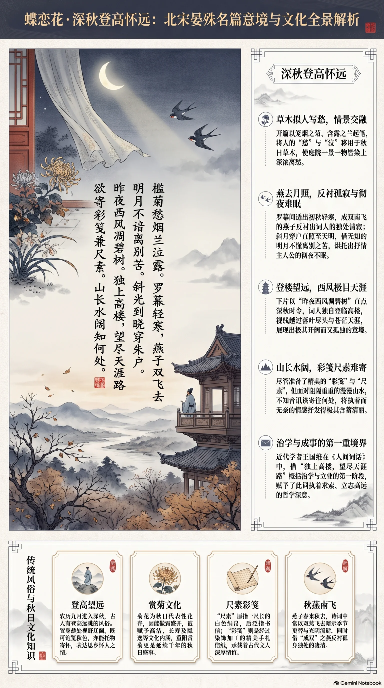

**北宋·晏殊** · 深秋登高怀远

## 诗词全文

槛菊愁烟兰泣露。罗幕轻寒，燕子双飞去。
明月不谙离别苦。斜光到晓穿朱户。
昨夜西风凋碧树。独上高楼，望尽天涯路。
欲寄彩笺兼尺素。山长水阔知何处。

## 赏析

这首词写深秋清晨至夜晚的怀人之情。开篇以笼着烟霭的菊花、沾着露珠的兰草起笔，“愁”“泣”本是人的情态，移用于草木，便使庭院景物也染上了离愁。帘幕间透出轻寒，成双的燕子飞去，反衬词人独处的清寂。上片末写月光斜照朱户直到天明，月亮本无知觉，却仿佛不懂离别之苦，更见人彻夜难眠。
下片由“西风凋碧树”点明深秋时令。词人独自登上高楼，极目远望，视线仿佛越过无尽天涯；然而山长水阔，纵有精美信笺和书信想寄，也不知该寄往何处。全词语言清丽含蓄，景与情层层推进。“独上高楼，望尽天涯路”后来还被王国维用来概括治学与成事的第一重境界，赋予了它执着求索的深远意味。

## 相关风俗

- 农历九月进入深秋，古人常有登高望远的习俗；高处视野开阔，既可赏秋景，也常寄托怀人与思归之情。
- 菊花是秋日最具代表性的花卉，因能傲霜开放，被赋予高洁、长寿与隐逸等文化象征，重阳赏菊尤为盛行。
- 古代书信常称“尺素”，原指一尺长的白色绢帛，后泛指书信；“彩笺”则是经过染饰加工的精美信纸。
- 燕子多在春来秋去，其成双飞去的形象常被诗词借来反衬离人孤单，也暗示季节更替和时光流逝。

## 背后的故事

> 这首词最耐人寻味处，在于它把闺阁式的帘幕、朱户、彩笺，与“独上高楼，望尽天涯路”的巨大空间并置。晏殊身居北宋宰辅、长于提拔后进，词中却不写朝堂而写无从投递的私情；数百年后，王国维又将这层离愁改读为治学者“第一境”的孤绝远望。

### 作者轶事

- 晏殊少有“神童”名声。据本传，他七岁即能属文，十四岁因张知白荐举被召试，赐同进士出身。这个过早进入宫廷文官体系的少年，后来成为真宗、仁宗两朝重臣；词里的闲愁因此尤其值得玩味：它并非失意书生的单一自白，而是仕途显达者仍须借柔婉小令安顿的幽微情绪。 〔史实 · 《宋史·卷三百十一·晏殊传》〕
- 欧阳修笔记记一段著名考场故事：晏殊应试时见题目是自己十日前已写过的赋，主动请求另命题；真宗欣赏其不欺。此事未必可逐字坐实，却塑造了后世所称“晏元献”端谨、从容的一面。与词中“欲寄”而不轻寄的克制姿态相映，颇可作人物性格素材。 〔传说 · 《归田录·卷一》〕
- 晏殊居相位时，范仲淹、韩琦、富弼等后来主导庆历政局的人物，都曾受其进用。本传特别记他“喜奖拔人物”，并非只是一位安享富贵的词人。若写他在高楼远望，可添一层反差：他所面对的“天涯”，既能是词中不可达的故人，也确实连接着庙堂上不断涌现的新一代士人。 〔史实 · 《宋史·卷三百十一·晏殊传》〕

### 本事与创作背景

- 《蝶恋花·槛菊愁烟兰泣露》见于《珠玉词》，但词前无小序，诸本也没有交代受词者、宴饮地点或作者行役。因此“寄给某位姬妾、友人”之类说法都无可靠依据。它最稳妥的本事，是以秋晨庭院、夜月朱户和高楼极目，层层写出欲通信而无从投递的离别情境。 〔史实 · 《珠玉词·卷上》〕
- “独上高楼”容易使人联想重阳登高，但词中没有重九、茱萸、菊酒等节令标志，也没有明确的送行对象。“昨夜西风凋碧树”只能确定为秋景书写；所谓“深秋登高怀远”宜视为阅读场景，而不宜坐实为一次有日期可考的重阳登临或真实别宴。 〔存疑〕

### 时代背景

- 晏殊经历真宗、仁宗两朝，终至同平章事，是北宋中期典型的馆阁—宰辅人物。词中罗幕、朱户、彩笺所呈现的富贵居室，与他的社会位置并不违和；但这不等于每一句都在影射政局。北宋士大夫词常将政治身份暂时悬置，在室内景物与离情之间经营另一种可低回反复的个人声音。 〔史实 · 《宋史·卷三百十一·晏殊传》〕
- “山长水阔”并不只是地理阻隔。在交通仰赖舟车、书信须托人递送的时代，一封信能否到达高度取决于行人路线与受书人的行止。词末不说“不能寄”，而问“知何处”，把失联写成空间的无限延展；这正是早期小令善于以具体生活难题承载抽象相思的方式。 〔存疑〕

### 风土人情

- 菊与燕共同校定了词中的秋令。《礼记·月令》称季秋“鞠有黄华”，菊黄是深秋的物候；又称仲秋“玄鸟归”，古人通常以玄鸟为燕。故“槛菊”带着将残未残的冷色，“燕子双飞去”则带有候鸟南归的动态。词人把植物的露、鸟的去与人的留，压入一个清晨庭院。 〔史实 · 《礼记·月令》〕
- 宋人重阳确有登高赏菊的习俗，汴京酒家还会以菊花装点门户，市民多出城郊登高。它可作为理解“高楼”“菊”相连时的风俗背景，却须注意：本词没有点明重阳，不能把词中登楼直接等同于节日活动。写作时可让节俗成为隐约的季节底色，不宜改写成确切情节。 〔史实 · 《东京梦华录·卷八·重阳》〕

### 民间传说与后世演绎

- 王国维在《人间词话》中把“昨夜西风凋碧树，独上高楼，望尽天涯路”列为成就“大事业、大学问”的“第一境”。在他的阐释里，原本面向离别的高楼远望，被提升为求道者先须看清辽阔前路的孤独。这是极有影响力的后世再创造，而非晏殊写作时已有的治学寓意。 〔史实 · 《人间词话·第二十六则》〕
- 现代教材、励志文字常将“望尽天涯路”单独摘出，连同柳永“衣带渐宽终不悔”、辛弃疾“众里寻他千百度”组合成“人生三境界”。这一组合的直接文本依据正是王国维，流传中却常抹去它原是文学批评中的借喻。若用于小说人物台词，可保留这种误读如何反过来塑造现代人阅读宋词的趣味。 〔附会 · 《人间词话·第二十六则》〕

### 典故与名物

- “尺素”本指可裁成尺许、用以书写的绢帛，后泛指书信。汉乐府《饮马长城窟行》写客人寄来“双鲤鱼”，剖开鱼形函套后“中有尺素书”，使尺素天然带着远客寄书、拆信见字的画面。晏殊说“彩笺兼尺素”，是把华美信纸与正式尺书并提，显出想写的不是一句草草问候。 〔史实 · 《乐府诗集·卷三十八·相和歌辞十三·饮马长城窟行》〕
- “天涯”在汉魏以来已是相隔万里的固定抒情空间。《古诗十九首》有“相去万余里，各在天一涯”，将不能相见的人安置在同一片天空的两端。晏殊的“望尽天涯路”未必直接摹拟该诗，但沿用了这一古老距离语汇；“尽”字尤其尖锐，目光已穷而道路仍无终点。 〔史实 · 《文选·卷二十九·古诗十九首》〕
- “朱户”是施朱漆的门户，“罗幕”则为质地轻疏的罗帷；二者都提示此地不是荒村旅舍，而是有庭院、栏槛与帷幕的富家或士大夫居处。词人故意让明月“穿朱户”、让西风凋庭树：华丽而封闭的室内，并不能遮断夜光和秋寒，反而使离人的孤居更显分明。 〔存疑〕
