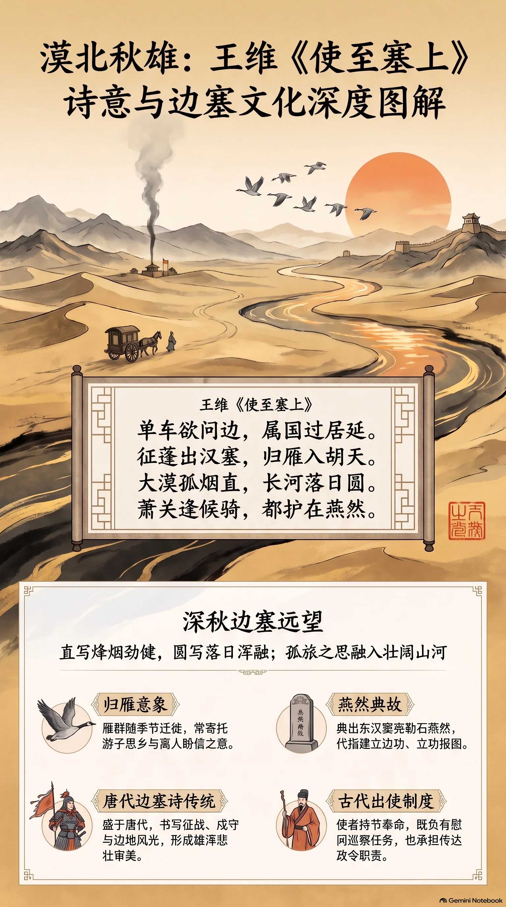

**唐·王维** · 深秋边塞远望

## 诗词全文

单车欲问边，属国过居延。
征蓬出汉塞，归雁入胡天。
大漠孤烟直，长河落日圆。
萧关逢候骑，都护在燕然。

## 赏析

十月中旬，秋意渐深，天空高远，候鸟南飞，正适合读王维这首兼具苍茫与宁静的边塞诗。诗写诗人奉命出使边塞时的所见所感：一辆孤车越过居延，自己仿佛被风吹出塞外的蓬草；天边归雁飞入辽阔胡地，也映照着行旅人的孤独。前四句以“征蓬”“归雁”写出远行的漂泊感，却不显哀伤，而有开阔的观察与自持。

“大漠孤烟直，长河落日圆”是千古名句。一个“直”字写烽烟在无风大漠中垂直上升，劲健而清晰；一个“圆”字写落日沉向黄河尽头，温厚而浑融。诗人以极简的线条、色彩和几何感，构成雄奇壮阔的塞上图景。末句写在萧关遇到侦骑，得知主帅仍在燕然前线，个人行程遂与守边将士的事业相连。全诗既有秋日行役的清寂，也有山河辽阔、边防安定所带来的雄浑气象。

## 相关风俗

- 古代“出使”常由使者持节奉命前往边地，既负有慰问、巡察任务，也承担传达朝廷政令的职责。
- “归雁”是中国诗词中的常见秋季意象。雁群随季节迁徙，常被用来寄托游子的思乡、离人的盼信。
- 边塞诗多兴盛于唐代，常书写征战、戍守、出使与边地风光，形成雄浑、悲壮或苍凉的审美传统。
- “燕然”典出东汉窦宪北击匈奴、勒石燕然山之事，后世诗文常以“勒燕然”代指建立边功。
- 古人重视重阳后的深秋时序，此时天高气清、草木渐黄，登高远眺与寄寓怀抱成为常见文化活动。

## 背后的故事

> 《使至塞上》最耐人寻味处，在于它并非单纯的旅行写景：王维以监察御史身份出使西北，诗中“属国”“候骑”“都护”皆带着边防公文与军镇生活的冷硬气息。至于“大漠孤烟直，长河落日圆”，又把一场有任务在身的行役，凝成了几乎脱离人事的苍茫画面。

### 作者轶事

- 王维并非只是一位隐逸诗人，也有相当清晰的仕宦履历。《旧唐书》称他由右拾遗迁监察御史，并曾“奉使出塞”。监察御史本有纠察、巡按之职，因此诗里的“单车”“问边”不是文人想象的漫游，而是一名朝官带着使命穿过边塞。清峻的构图背后，实际有公差行程的紧迫感。 〔史实 · 《旧唐书·卷一百九十下·王维传》〕
- 王维晚年奉佛甚深，母亲崔氏亦信佛；其妻亡后长期未再娶，《旧唐书》说他“孤居一室，屏绝尘累”。这类经历常被用来解释其诗境的澄明，但不宜反推《使至塞上》便是纯粹的禅诗。此诗的空阔，首先来自荒漠、军塞与使者身份，其次才可与诗人后期的静观气质相参照。 〔史实 · 《旧唐书·卷一百九十下·王维传》〕

### 本事与创作背景

- 题中“使至”明言奉使抵达，“问边”即巡视、慰问边防情状。“属国”本是汉代主管少数族属事务的官名，王维借汉官语写自己的使者身份，使唐代西北行程染上一层两汉边塞的历史色彩。末句从萧关候骑得知“都护在燕然”，写的正是使者进入军镇后，向前线打听主帅行踪的场景。 〔史实 · 《全唐诗·卷一百二十六》〕

### 时代背景

- 开元后期，唐朝在西北设置河西、陇右等节度军镇，以应对吐蕃及北方诸部的压力。边地不只是“塞外风光”，而是粮道、烽燧、斥候与军府高度密集的军事地带。王维诗中反复出现汉塞、胡天、候骑、都护，正是盛唐将边疆纳入常态化军政管理后形成的一套语言。 〔史实 · 《新唐书·兵志》〕
- 盛唐诗人写边塞，常不用当代军政术语的全称，而偏爱“汉”“胡”“燕然”等古典化词汇。这并不表示诗中时代是汉代，而是一种借汉代抗击匈奴的记忆来标举唐朝边功的写法。王维以“征蓬”“归雁”自况，也把奉使者的孤身行役，置入传统边塞诗的苍凉语汇之中。 〔史实 · 《全唐诗·卷一百二十六》〕

### 风土人情

- “归雁”并非泛泛的悲秋意象。《礼记·月令》将鸿雁来去列入秋令物候：仲秋“鸿雁来”，季秋“鸿雁来宾”。深秋北方雁群南迁，正与诗人向西北边地前行形成方向上的反差。雁有归期，奉使者却像“征蓬”被风吹出汉塞，这种对照使旅愁不必直说而自见。 〔史实 · 《礼记·月令》〕
- “孤烟”通常被理解为边塞烽烟，但民间常把它说成“狼粪烟”。沈括记西北用狼粪举烟，称其烟“直而聚，虽风不斜”，这与“大漠孤烟直”极相切合。不过《梦溪笔谈》是宋人见闻，不能据此断定王维眼前必是狼粪所燃；可将其作为后世解释“烟直”的一条边地知识，而非定论。 〔存疑 · 《梦溪笔谈·卷二十四·杂志一》〕

### 典故与名物

- “属国”来自汉代“典属国”官。典属国掌管归附的少数族群及相关事务，汉代边政意味很浓。王维并非唐代典属国官员，却以“属国”代指奉命涉边的使者；这是一种有意的汉代化自称。读到“属国过居延”，应同时听见现实使行与古代边塞文辞两层声音。 〔史实 · 《汉书·卷十九上·百官公卿表上》〕
- 居延在汉代属张掖郡，是河西北部通向漠北的重要边地，今遗址大体在额济纳一带。它在诗中未必能当作精确的行程地图：王维所写兼有实际地名与边塞文学的广阔视野。“过居延”尤其能把读者带到汉简、戍卒、烽燧和绿洲断水相接的西北边缘。 〔史实 · 《汉书·卷二十八下·地理志下》〕
- “燕然”指燕然山，典出东汉窦宪北伐。窦宪破北匈奴后命班固作铭，刻石纪功于燕然山；“勒石燕然”遂成为边将大捷的象征。诗中都护“在燕然”，未必是说主帅真驻于东汉旧山，更像以这一胜利地名概括其深入塞外、经营前线的军功姿态。“候骑”则是负责侦察、传递军情的骑兵。 〔史实 · 《后汉书·卷二十三·窦融列传》〕
