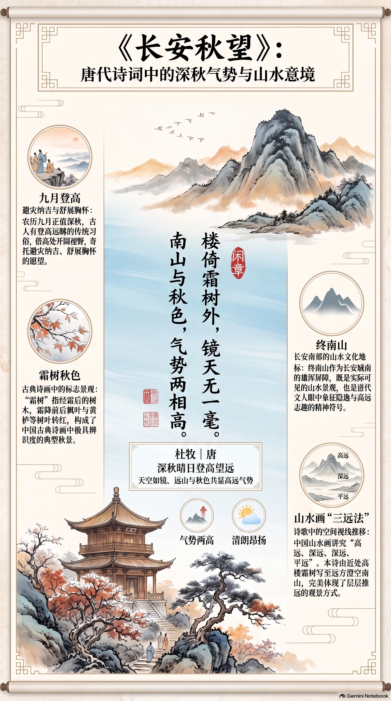

**唐·杜牧** · 深秋晴日登高望远

## 诗词全文

楼倚霜树外，
镜天无一毫。
南山与秋色，
气势两相高。

## 赏析

农历九月初六，正是秋意渐深、天宇澄澈的时节。这首五言绝句写诗人登楼远望长安秋景：近处楼阁依傍着经霜的树木，远处天空如明镜般洁净，纤尘不染；终南山的雄浑轮廓与满目秋色相映，仿佛彼此竞相高耸。诗中没有直接抒发愁绪，而以“霜树”“镜天”“南山”等明丽、阔大的意象，展现出秋日特有的清峻与壮阔。“无一毫”极写天空的澄明，也使视野从楼前延展至远山。末句将本无形态的“秋色”写得仿佛能与南山并立，既有想象力，又增强了画面的空间感。杜牧笔下的秋天并非萧瑟衰飒，而是清朗、昂扬、富有力量，适合在晴朗凉爽的深秋日阅读，感受收敛之后的辽阔心境。

## 相关风俗

- 农历九月通常处在深秋，古人常有登高远眺的习俗，借高处开阔视野，也寄托避灾纳吉、舒展胸怀的愿望。
- “霜树”指经霜后的树木。霜降前后，枫叶、黄栌等叶色转红，形成中国古典诗画中极具辨识度的秋景。
- 终南山位于长安南郊，是唐代文人眼中重要的山水地标。它既是实际可见的屏障，也常象征隐逸与高远志趣。
- 中国山水画讲究“高远、深远、平远”。本诗由近楼、霜树写到镜空、南山，正体现了层层推远的观景方式。

## 背后的故事

> 此诗最耐人寻味处，在于它并非单写“秋高气爽”，而是把长安城楼、城南终南山和澄澈天空压缩进二十字：近处霜树像画框，远处南山与秋色一同昂起。杜牧本为京兆人，熟悉这座都城南望终南的空间格局；但诗无序跋，成诗年月与具体登楼地点反而不可坐实。

### 作者轶事

- 杜牧字牧之，京兆万年人，即长安近畿人士。他并非只是在仕途中偶然路过京城，而是生长于关中士族环境，对城南终南山、京畿楼观与季节物候自有近身经验。读“南山”时，不妨先把它看作本地人日常视野中的巨型背景，而不必急着解成抽象的隐逸符号。 〔史实 · 《旧唐书·杜牧传》〕
- 正史称杜牧“刚直有奇节，不为龊龊小谨”，又以文章见长。他的诗常能在极短篇幅中做出开阔、峭拔的格局；《长安秋望》末句“气势两相高”并非柔婉的伤秋，而是以山色和秋意彼此竞高，颇可与其好论兵、重气概的一面互相参看。 〔史实 · 《新唐书·杜牧传》〕

### 本事与创作背景

- 现存文本只有题目《长安秋望》与四句诗，没有序、跋、赠答对象或具体楼名可供追索。它是一首五言绝句：前二句先立楼与天的上下纵深，后二句把视线推向南山。所谓“深秋晴日登高”可由诗意概括，却不能进一步断言是重阳登临，或指定为长安某一座名楼。 〔史实 · 《全唐诗·卷五二四》〕

### 时代背景

- 唐长安的地理格局使“南山”几乎成为都城南面的天然屏障。京兆府南部接近终南山脉，晴日自城中高处南望，山势与天空容易形成诗中这种近楼、远树、极天、长山层层展开的构图。因此“南山”首先是长安的实景方位，而非泛指任意南方山岭。 〔史实 · 《元和郡县图志·卷一 京兆府》〕
- 杜牧仕宦活动主要在晚唐文宗、武宗、宣宗诸朝，其时代确有藩镇、宦官与朝局反复等沉重背景；但此诗没有可核对的时事语汇。若把“气势两相高”直接说成政治讽喻，便越过了证据。它更可靠的读法，是晚唐诗人面对帝京山河时，暂将现实压力收束为澄明而雄浑的视觉经验。 〔史实 · 《旧唐书·文宗纪下》〕

### 风土人情

- 秋日登高在唐代已是显著的节令行为，尤其九月九日，人们有登高、饮酒、佩茱萸等习俗。杜牧诗中写“霜树”“秋色”，很适合与这一文化背景联想；但诗内没有九日、菊花、茱萸、酒宴等标记，故只能说它借用了秋季登临的共同情境，不能定为重阳应制或节日宴集。 〔史实 · 《荆楚岁时记·九月九日》〕
- “霜树”并不一定指树上已结厚霜，也可写深秋草木经霜后颜色转劲、枝叶疏朗的视觉状态。传统物候将霜降置于秋末，认为此后草木渐黄、虫蛰；诗人登楼时先见树梢，再见无纤尘的天空，正是北方秋季空气清澈、远景格外突出的经验，而非单纯以寒意写愁。 〔史实 · 《月令七十二候集解·霜降》〕

### 典故与名物

- 诗题及第三句的“南山”，在长安语境中通常指终南山，古人也常以“南山”作其简称。终南山在汉代已是关中帝王苑囿与京畿地理的重要部分，后来又因道观、寺院和隐士传统而名声极盛。杜牧此处只取其横亘城南的实景气势，并无证据表明专门在追摹某位终南隐士。 〔史实 · 《汉书·东方朔传》〕
- “镜天无一毫”以镜喻澄空，“一毫”则把天空的洁净写到连极细微的尘翳也没有。它未必是严格用典，但“秋毫”作为极微之物，早见于《孟子》“明足以察秋毫之末”。杜牧把本可用来衡量目力的“毫末”移来衡量天宇，遂使秋日的高远有了近乎触手可验的质感。 〔史实 · 《孟子·尽心上》〕
