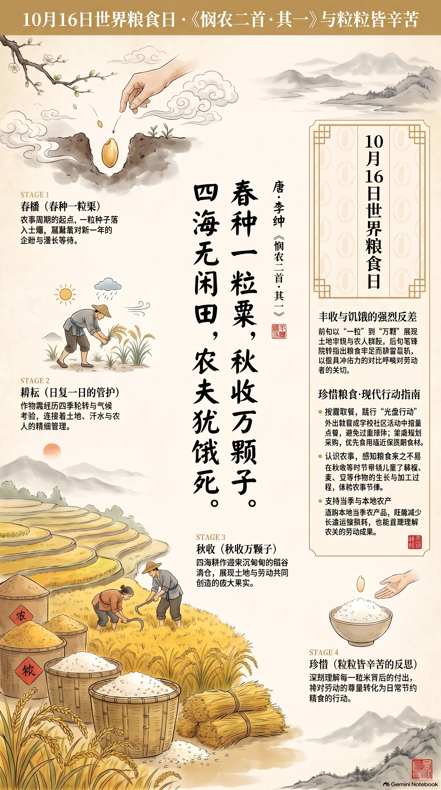

**唐·李绅** · 世界粮食日

## 诗词全文

春种一粒粟，秋收万颗子。
四海无闲田，农夫犹饿死。

## 赏析

10月16日是世界粮食日，旨在关注粮食安全、农业发展与消除饥饿。李绅《悯农二首·其一》以极凝练的二十字，揭示了农业社会中最尖锐的矛盾。前两句从“一粒粟”到“万颗子”，用鲜明的数量对比写春播秋收，展现土地的丰饶与农人辛勤劳作所创造的巨大收获。“春种”“秋收”四字点出完整农事周期，也暗含日复一日的耕耘等待。后两句笔锋陡转：天下田地似乎没有荒废，粮食生产并不缺乏，真正耕作的农夫却仍可能忍饥受饿。诗人不作铺陈叙事，只以强烈反差发出沉痛诘问，使丰收图景反而更显悲凉。今天读它，不仅能体会古代农民的艰辛，也能理解珍惜粮食、改善农业生产与分配、尊重劳动者的现实意义。每一粒米都连接着土地、气候、汗水和漫长的等待。

## 相关风俗

- 世界粮食日设于10月16日，由联合国粮农组织倡议，提醒公众关注饥饿、营养、农业与粮食安全问题。
- 家庭可按人数规划采购和烹饪，优先食用临近保质期食材，剩菜及时冷藏并在安全期限内加热食用。
- 在学校或社区开展“光盘行动”时，可从按需取餐做起，避免用过量点餐来表达热情或排场。
- 秋收时节可带孩子认识稻、麦、豆等作物的生长过程，理解一粒粮食需经历播种、管理、收获与加工。
- 选购食物时适当支持当季、本地农产品，既能减少长途损耗，也有助于理解农民劳动与农业生产节律。

## 背后的故事

> 《悯农》最耐人寻味处，不只在“谁知盘中餐”的朴素劝诫，而在作者李绅后来竟官至宰相、节度使，又因“吴湘案”留下严酷名声。一首替农夫发问的诗，和一个身居权力中心的诗人，构成了唐代土地、赋役与仕途之间颇具张力的互文。

### 作者轶事

- 李绅字公垂，润州无锡人。元和元年登进士第，仕途自校书郎、地方观察使而至宰相，晚年又镇淮南。这样一位由文名进入权力中枢的士人，写出“农夫犹饿死”，并非纯粹田园诗人的旁观感叹，而是官僚社会内部对民生困局的一次发声。 〔史实 · 《新唐书·李绅传》〕
- 李绅身后名声颇有反差。史传记其在淮南时曾审理吴湘案，吴湘后被认定冤死；唐宣宗因此追夺李绅官爵，并限制其子孙仕进。后人每把此事与《悯农》的悲悯口吻并置，感叹诗人笔下的恤农之心，未必能完全转化为掌权后的政治德性。 〔史实 · 《旧唐书·李绅传》〕

### 本事与创作背景

- 此诗题作《悯农二首》，与第二首“锄禾日当午”相为表里：一首写从春种到秋收的总体悖论，一首写烈日锄禾的具体劳作。传世文本没有序跋、题注或同时人唱和可说明写作地点与触发事件；将它坐实为作者亲见某地饥荒，属于无据推断。 〔存疑〕

### 时代背景

- “四海无闲田”不是唐代土地利用率的统计报告，而是以“天下”口吻制造反讽：田地仿佛都已开垦，粮食也似乎丰收，耕作者却仍会饿死。中唐财政在安史之乱后改行两税法，赋税按资产、田亩及夏秋征收，农业产出与农户实际温饱之间并不必然相等。 〔史实 · 《资治通鉴·卷二百二十五》〕
- 唐后期的农民并不只是自给自足的“种田人”。租佃、赋税、差役、运输以及地方军镇的需求，都可能不断分走收成。诗中“秋收万颗子”紧接“犹饿死”，把丰年与饥馑硬折在一起，正击中农业社会中“谷多而民未必富”的制度性焦虑，而非单纯哀叹天灾。 〔史实 · 《旧唐书·食货志下》〕

### 风土人情

- “粟”通常指粟米，即今所称谷子，去壳后为小米，是北方旱地农业的重要粮食。它耐旱、成熟较快，适合与麦、豆等作物配合种植。李绅用“一粒粟”起笔，既是可握在指间的种子，也让读者看到农家必须从当年收成中留出籽种的现实。 〔史实 · 《说文解字·米部》〕
- 古代农业格外重视“收种”：秋收并不意味着全数入口或入仓，还要挑选饱满干燥的谷粒留作来春种子。贾思勰专设《收种》《种谷》等篇，细论收获、曝晒、贮藏与下种。诗中从“春种”到“秋收”的两句，压缩的正是一整轮不能轻易中断的农事历法。 〔史实 · 《齐民要术·卷二·收种》〕

### 典故与名物

- “四海”本是古代以四方海域环绕天下的宇宙地理观，后常代指整个天下、全体臣民。李绅说“四海无闲田”，并非真说海内每一寸土地都已耕作，而是故意把视野推至最大：若天下处处有田、有收成，为何最直接的生产者还会饿死？ 〔史实 · 《尚书·禹贡》〕
- “一粒”与“万颗”是诗歌常用的极小与极大的对照，不宜按实数理解。“粒”突出种子细微、起点艰难；“万”则写穗实繁多、收获可观。两种量感之间的急剧放大，使末句的“犹”字格外沉痛：产量的增长并没有自动保证分配的公正。 〔史实 · 《全唐诗·卷四八一》〕
