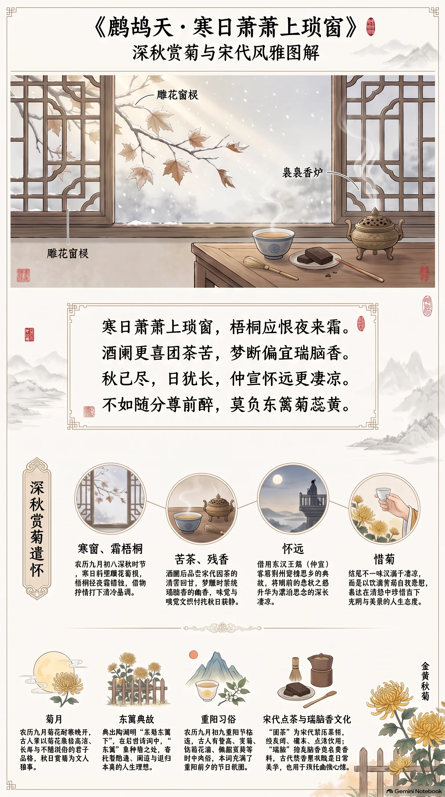

**宋代·李清照** · 深秋赏菊遣怀

## 诗词全文

寒日萧萧上琐窗，梧桐应恨夜来霜。
酒阑更喜团茶苦，梦断偏宜瑞脑香。
秋已尽，日犹长，仲宣怀远更凄凉。
不如随分尊前醉，莫负东篱菊蕊黄。

## 赏析

农历九月初八，正是深秋渐入晚境、菊花盛放的时节。这首词以清冷而精致的闺阁秋景开篇：寒日透过雕花窗棂，梧桐经霜，仿佛也含着愁绪。“团茶苦”写饮茶后的清苦回甘，“瑞脑香”则是香料燃尽后仍萦绕室内的幽香；味觉与嗅觉交织，使秋日的寂静格外可感。下阕由眼前秋色转入怀远之情。“仲宣”指东汉王粲，他曾客居荆州、登楼思乡，词人借此典故写出漂泊与思念的深长。结尾却不一味沉溺于悲凉，而以“随分尊前醉，莫负东篱菊蕊黄”自我宽慰：既然菊花正好，便应珍惜当下的酒意与秋光。这种在清愁中保持清醒、在有限时光中发现可珍重之物的心境，正是宋词含蓄而有力量的魅力。

## 相关风俗

- 农历九月常被称为菊月。菊花耐寒晚开，古人常以其象征高洁、长寿与不随流俗的品格，秋日赏菊也因此成为雅事。
- “东篱”典出陶渊明“采菊东篱下”。后世诗词中，东篱不仅指种菊之处，也常寄托隐逸、闲适与返归本真的人生理想。
- 重阳节在农历九月初九，临近此日常有登高、赏菊、饮菊花酒、佩茱萸等习俗。此词写菊蕊正黄，尤具重阳前夕的时令意味。
- 词中的“团茶”是宋代常见的紧压茶饼，饮用前须炙烤、碾末、点汤。宋人饮茶讲究色、香、味，也形成了精细的点茶文化。
- “瑞脑”是名贵香料，通常指龙脑香一类。古代文人闺阁常焚香或熏衣，香气既服务日常生活，也常被诗词用来烘托幽微心绪。

## 背后的故事

> 这阕词最耐人寻味处，不只在“菊蕊黄”的清秋图景，而在词人把苦茶、瑞脑香、残酒和长日拼成一室独处的感官秩序。“仲宣怀远”又忽然打开乱后羁旅的历史纵深：赏菊本可雅集，此处却成了以醉自遣、强压乡愁的日常仪式。

### 作者轶事

- 李清照早年与赵明诚以金石书画相尚。她在《金石录后序》中追忆，夫妇每得一书、一画或一器，便“展玩咀嚼”，又曾以饭后归来、猜书中某事在第几卷几页为戏，猜中者先饮茶。这种带着学者气的闺房游戏，使词中“团茶苦”不只是解渴之物，也容易让人联想到她以器物、书卷和清饮组织生活的习惯。 〔史实 · 《金石录后序》〕
- 赵明诚卒后，李清照一度改嫁张汝舟，旋即察觉其人有诈，告发并离异。宋代法律中妻告夫本有连坐、入狱的风险，她仍选择诉讼；《宋史》记其“讼而离之”。这段经历不宜机械套入本词，却可作为理解她晚年“随分”“莫负”式自我劝慰的背景：那并非全然闲适，而是屡经破败后争得的一点自主。 〔史实 · 《宋史·卷四百四十四·李清照传》〕

### 本事与创作背景

- 词的叙事镜头极小：寒日照到雕饰窗棂，夜霜压梧桐，饮酒将阑，遂以苦茶和熏香收束残醉；下片才从室内推向“怀远”，最后以东篱黄菊自劝。它不像为宴会即席唱和，更近于深秋独居时的遣怀小令。只是“深秋赏菊遣怀”可由文本坐实，具体写给何人、写于何地，则无可靠题序可证。 〔史实 · 《漱玉词·鹧鸪天（寒日萧萧上琐窗）》〕
- “仲宣怀远更凄凉”常被视作南渡离乱后思乡、念旧的线索：王粲在荆州久客而作《登楼赋》，李清照也经历北方故园沦陷、携书画南奔的动荡。不过此词并未点明建康、临安或赵明诚亡故，且《漱玉词》的篇年传承复杂；将它确指为赵明诚死后某年秋作，属于有吸引力却尚不能落实的推断。 〔存疑〕

### 时代背景

- 靖康之变后，北宋覆亡，高宗南渡，士大夫与宗室、百姓大批迁徙。李清照在《金石录后序》中记述，自青州南下，经江宁、越地等处，原先积聚的图书金石在兵火、散失与转运中不断损耗。因而词里“日犹长”的难耐，若置于南宋初年，便不只是伤秋的传统腔调，也可承载故国难归、旧藏难全的漫长空白。 〔史实 · 《金石录后序》〕
- 宋人的都市与士人家庭已形成精细的消费和闲居文化：点茶、焚香、插花、挂画常被并称为生活雅事。词中先酒、继茶、再以瑞脑香醒梦，正是把身体从醉意、苦味、香气中逐层安顿；这种细密感官书写，也说明“闺阁词”并非只有软语，而能把物质生活写成心理的刻度。 〔史实 · 《梦粱录·卷十三·四司六局筵会假赁》〕

### 风土人情

- “团茶”是宋代常见的蒸青、研膏、压模成饼的茶，饮时须炙、碾、罗、候汤、击拂，并非后世直接冲泡的散茶。北宋贡茶尤重建安北苑，茶饼上往往压印花纹、龙凤等纹样。李清照说“更喜团茶苦”，写的是酒后以浓苦茶醒神；一个“苦”字使雅饮带上药石般的清醒意味。 〔史实 · 《大观茶论·序》〕
- “东篱菊蕊黄”把晚秋赏菊、饮酒的习俗，和隐逸传统叠在一起。重阳前后佩茱萸、饮菊花酒、赏菊，本为岁时风俗；至陶渊明“采菊东篱下”后，菊又成为不随流俗的文化标记。词中不说采菊，而说“莫负”黄蕊，像是对眼前短暂花事的挽留：人生既不可尽如意，至少不要辜负杯前秋色。 〔史实 · 《荆楚岁时记·九月九日》〕

### 典故与名物

- “仲宣”是东汉文学家王粲之字。王粲避乱依刘表于荆州，久客思归，登麦城楼而作《登楼赋》；赋中有“虽信美而非吾土兮，曾何足以少留”，正是身在佳境而不能忘故乡。李清照只举其字而不铺陈典故，以“怀远”接“凄凉”，便将个人的秋日孤居纳入乱世游子的共同情感。 〔史实 · 《昭明文选·卷十一·登楼赋》〕
- “瑞脑”通常指龙脑香一类名贵香料，宋人也以“瑞龙脑”称之。它可入香丸、香饼，焚之气味清凉馥郁，亦可作药用。词中“梦断偏宜瑞脑香”并非单写富贵陈设：酒醒梦断之际，冷香最适合清理昏沉，与上句团茶的苦味相互映照。李清照另一首《醉花阴》亦写“瑞脑销金兽”，可见此物是其词中反复出现的室内香事。 〔史实 · 《漱玉词·醉花阴（薄雾浓云愁永昼）》〕
