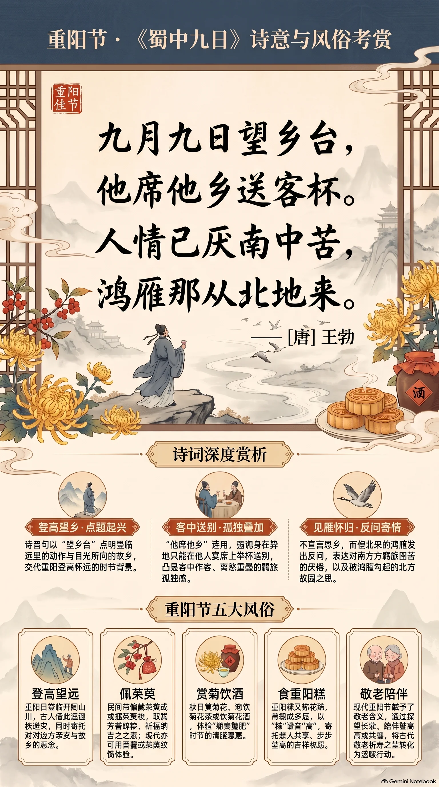

**唐代·王勃** · 重阳节

## 诗词全文

九月九日望乡台，
他席他乡送客杯。
人情已厌南中苦，
鸿雁那从北地来。

## 赏析

农历九月初九为重阳节，古人有登高、饮酒、佩茱萸、思亲怀乡的传统。王勃此诗作于滞留蜀地期间，题中“九日”即重阳登高之日。“望乡台”三字先点出诗人登临远望的动作，也点出目光所向的故乡；然而身在异地，只能在宴席上举起为送别而设的酒杯，“他席他乡”连用，强化了客中作客、离愁叠加的孤独感。后两句转入更深一层的感慨：南方羁旅的困苦已令人厌倦，偏偏北来的鸿雁又勾起对北方故园的思念。诗人不直说“我想家”，却借鸿雁的来处反问，将重阳思亲的普遍情绪写得格外真切。全诗仅二十八字，情感由登高望乡、席间送别而至见雁怀归，层层递进；语言质朴而含蓄，正是重阳诗中以节令触发乡愁的经典篇章。

## 相关风俗

- 重阳日宜登高望远，古人借登临迎秋避灾，也在开阔山川间寄托对亲友与故乡的思念。
- 民间常佩茱萸或插茱萸枝，取其芳香辟秽、祈福纳吉之意；如今可用香囊、茱萸纹饰体验这一习俗。
- 重阳有赏菊、饮菊花酒的传统。秋日可赏菊、泡饮菊花茶，感受“菊黄蟹肥”时节的清雅意趣。
- 重阳糕又称花糕，常做成多层，寓意“步步登高”。家人可共享糕点，以“糕”谐“高”寄托吉祥祝愿。
- 现代重阳节也是敬老节，可探望长辈、陪伴登高或共餐，将古代敬老祈寿之意落实为温暖行动。

## 背后的故事

> 这首四句诗最耐咀嚼处，在于它把重阳本应登高避灾、携酒宴饮的节俗，翻成了羁旅者的反讽：人站在“望乡台”上，喝的却是替人送别的酒；南方客居已令人厌苦，偏又见北来的鸿雁。王勃早年因《檄英王鸡文》获罪出府，漫游蜀地的经历，使这种少年才子骤然失意的口气格外真切。

### 作者轶事

- 王勃少年以文名动京师，先授朝散郎，后被沛王李贤召入王府修撰。他曾戏作《檄英王鸡文》，把诸王斗鸡写成两军交锋；唐高宗见文大怒，认为它有挑拨诸王之嫌，遂将王勃斥出王府。一个靠文章进身的少年，亦因文章顿失仕途依凭，游蜀时期的乡愁便不只是客愁。 〔史实 · 《旧唐书·卷一百九十上·文苑上·王勃传》〕
- 王勃后来赴交趾探望任县令的父亲王福畤，渡海时船只遇险溺死，年未及三十。传记以“年二十八，溺水而卒”收束其一生。读《蜀中九日》时，可注意其“望乡”并非暮年回顾，而是一个声名甚早、行路已多的青年，在异地对北方家园发出的急切呼唤。 〔史实 · 《旧唐书·卷一百九十上·文苑上·王勃传》〕

### 本事与创作背景

- 诗题明确标出“蜀中”与“九日”，正文则从登台望乡、异席送客写到厌倦“南中”羁苦，末以北来鸿雁反问收住。现存诗篇没有序、跋或受赠者姓名，不能坐实为送某一位友人；但“送客杯”至少表明，诗人是在重阳宴饮、饯别友人的现场，忽然把节日的热闹转成了自己的乡思。 〔史实 · 《全唐诗·卷五十六》〕
- “他席他乡送客杯”连用两个“他”字，语意并非泛泛说人在异地，而是强调席非己席、客亦非己客：自己寄食于他人的宴会，却还要举杯送别人远行。这样的写法使重阳酒不再是团聚之饮，而近于借来的社交礼数；诗人真正想送出的，是无从寄达的归心。 〔史实 · 《全唐诗·卷五十六》〕

### 时代背景

- 初唐王府常延揽能文之士，文学既是进身门径，也是政治风险所在。王勃在沛王府因斗鸡檄文被斥，说明宗室交游并非纯粹的文酒场，文字一旦触及诸王竞逐，便可能被视作越界。《蜀中九日》中“厌南中苦”的低回，宜放在这种由京华仕进转入远游的断裂中理解。 〔史实 · 《旧唐书·卷一百九十上·文苑上·王勃传》〕
- 诗题称“蜀中”，句中却说“南中”，不是唐代某一严格固定的行政区名。就诗歌视角而言，蜀地相对于王勃的北方故乡，已是遥远的西南边地；“北地”也主要是情感方位，而不必拘指一州一郡。标题给出实际旅次，诗句则用南北对照拉开归路的距离。 〔史实 · 《全唐诗·卷五十六》〕

### 风土人情

- 九月九日为重阳。南朝以来的岁时记载称，此日人们结伴登高、野饮宴集，并佩茱萸以避恶气；菊花与酒也逐渐成为这一节日的标志。因此“望乡台”本应是登高取景之处，“送客杯”本应有令节欢会的暖意。王勃却让登高只见乡关、饮酒反成送别，正是借节俗写出反节俗的孤清。 〔史实 · 《荆楚岁时记·九月九日》〕
- 唐人重阳宴饮并不只限家人团聚，也常是宾朋登临、饯送酬唱的日子。诗中不写菊、茱萸等显眼节物，只拈出一只“送客杯”，反倒接近行旅生活的真实：在客地逢佳节，参与的是主人家的酒席和朋友的离筵，自己的归期却无人可问。 〔史实 · 《全唐诗·卷五十六》〕

### 民间传说与后世演绎

- 后世谈重阳，常讲桓景随费长房学道的故事：费长房预言九月九日家中有灾，命桓景携家人登高，佩茱萸囊、饮菊花酒；归来见家畜暴死，遂说它们代人受祸。这一叙事使登高、茱萸、菊酒被解释为禳灾之举。它并非王勃诗的直接典故，却能为“九日登台”补出民俗的神怪底色。 〔传说 · 《续齐谐记·九月九日》〕

### 典故与名物

- “鸿雁”在此既是实景，也是书信意象。汉代苏武被扣匈奴时，汉使谎称天子在上林苑射得一雁，雁足缚有苏武书信，迫使单于承认苏武尚在；此后“雁书”“雁足”成为音信的典型譬喻。王勃问雁为何从北方飞来，表面怨其只带来北地消息，深处实盼它能替自己传递乡书。 〔史实 · 《汉书·卷五十四·苏武传》〕
- “望乡台”不宜轻率坐实为某一处蜀中名胜或某个专属典故。就诗句结构看，它首先是重阳登高时供人远眺的高台；“望乡”则把普通登临动作定向为对故园的凝视。后世若将其硬指为某处遗址，多属以地名附会诗意；理解此诗时，保留它作为诗人临时所见高处的开放性更为稳妥。 〔存疑〕
