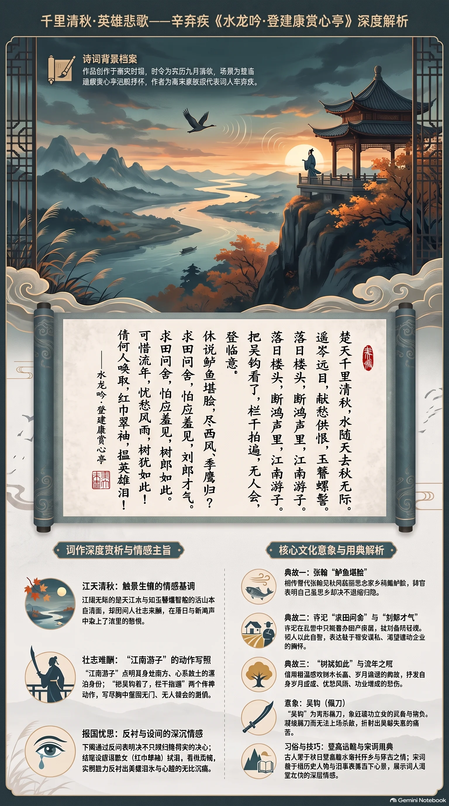

**南宋·辛弃疾** · 清秋登临

## 诗词全文

楚天千里清秋，水随天去秋无际。遥岑远目，献愁供恨，玉簪螺髻。落日楼头，断鸿声里，江南游子。把吴钩看了，栏干拍遍，无人会，登临意。

休说鲈鱼堪脍，尽西风、季鹰归未？求田问舍，怕应羞见，刘郎才气。可惜流年，忧愁风雨，树犹如此！倩何人唤取，红巾翠袖，揾英雄泪！

## 赏析

农历九月，正是“楚天千里清秋”的时节。这首词写辛弃疾登临建康赏心亭所见所感：江天辽阔、远山如玉簪螺髻，落日、孤鸿等秋景本自清丽，却因词人壮志未酬而染上愁恨。“江南游子”点出他身处南方、心系故土的漂泊身份；“把吴钩看了，栏干拍遍”两个动作尤为传神，写尽胸中报国无门的激愤。下阕连用典故：张翰因秋风思鲈脍而归乡，词人却反问自己岂能只顾归隐；许汜求田问舍，被刘备轻视，表明他不愿苟安；“树犹如此”又感叹岁月流逝、功业难成。结尾设想请歌女拭泪，看似柔婉，实则反衬英雄泪的沉痛。全词把壮阔秋景、历史典故与慷慨心声熔为一体，是豪放词中情景交融的典范。

## 相关风俗

- 古人有秋日登高、临水远眺的习俗，既为赏景舒怀，也常借高处视野寄托怀乡、怀古与自省之情。
- “鲈鱼堪脍”用张翰典：相传张翰见秋风起，思念家乡莼羹鲈脍，便辞官归里，后成为思乡归隐的典故。
- 重阳前后的深秋常与菊花、登高、饮酒相连。词中虽未直写重阳，却以清秋、西风、落日构成相近的时令意境。
- “吴钩”是弯形佩刀，文学中常象征建功立业的武备与抱负；凝视佩刀而不得施展，更显英雄失意。
- 宋词善于“用典”，即借历史人物和旧事表达当下心意。了解典故后，能读出词人不愿苟安、渴望北伐的深层情感。

## 背后的故事

> 这首词最锋利处，在于辛弃疾把一次普通的秋日登亭，写成了南归志士的政治自白。“鲈鱼脍”本是张翰知足归乡的佳话，他却反问自己岂能随风退隐；“求田问舍”本是许汜的庸俗，他借刘备之口斥其无大志。满眼清秋、落日、断鸿，终于都汇成一句“揾英雄泪”。

### 作者轶事

- 辛弃疾不是单纯的书斋词人。二十一岁时，他参加耿京领导的北方义军；义军中张安国杀耿京降金，辛弃疾从南宋渡江北返，率数十骑突入数万人的金军营中，缚出张安国，昼夜驰归。后来词中反复出现的剑、马、楼头与北望，并非想象中的豪语，而有青年行伍生活作底色。 〔史实 · 《宋史·卷四百一·辛弃疾传》〕
- 南归后，辛弃疾并未立刻得到北伐重任。他曾上《美芹十论》，从守江、练兵、用间直到收复故土，条列形势；又有《九议》论边防。朝廷虽称其才，却多把他安置在地方行政和屯田、治盗等事务中。这种“有策而不用”的经历，正使“无人会，登临意”不只是孤高，而是仕途中屡受抑塞的实感。 〔史实 · 《宋史·卷四百一·辛弃疾传》〕

### 本事与创作背景

- 此词通常系于淳熙元年建康任上。建康即今南京，临大江、控淮泗，是南宋东部防线的枢纽；赏心亭又适合远眺江天。词中“江南游子”表面是登临者自称，实暗含作者本籍山东济南、南归后长期羁寓江南的身份裂缝：他在南宋为官，精神上却仍把沦陷的北方当作故园。 〔史实 · 《宋史·卷四百一·辛弃疾传》〕
- 词题只称“登建康赏心亭”，词中也没有赠答对象、序文或纪日，因此不能坐实为某次宴集、某位友人所作。现存词集所能确认的是登临地点与抒情场景；把“拍遍栏干”具体附会为一次失意罢官或密议北伐，皆缺少同时代材料。它更像一次将积年抱负集中爆发的独游。 〔史实 · 《稼轩长短句·卷一》〕

### 时代背景

- 辛弃疾南归时，宋金之间刚经历隆兴北伐的失败。隆兴二年议和后，南宋朝廷以守成为主，恢复中原虽仍是政治语言，却很少落实为大规模军事行动。故词中“吴钩”不是闲赏兵器，“无人会”也不只是知音难觅：对于主战者而言，朝廷的谨慎、士大夫的苟安，都是看得见却难以冲破的栏干。 〔史实 · 《宋史·卷三十三·孝宗本纪一》〕
- 建康在南宋并非普通江南名城。它曾是六朝和南唐旧都，南渡后又扼守长江下游；隔江北望，便是金人控制的淮北方向。词开篇把“楚天”“江水”“远岑”铺得极阔，末尾却落在一人拍栏、拭泪的近景，正是南宋前线大城常见的心理地理：山河仍在，版图却被江淮防线截断。 〔史实 · 《宋史·卷四十·地理志三》〕

### 风土人情

- “鲈鱼堪脍”点出江南秋令最有名的时鲜。脍是把鲜鱼切成细片食用，吴中又以莼菜羹、鲈鱼脍相配，秋风一起便容易引动乡思。张翰因思念这一口吴中滋味而辞官归里，原是文人羡慕的适意故事；辛弃疾偏说“休说”，正是拒绝把饮食乡愁变成退隐的借口。 〔史实 · 《晋书·卷九十二·文苑传·张翰》〕
- 词末“红巾翠袖”写的不是抽象美人，而是宴饮、歌席间可见的侍女或歌妓装束：红色头巾与青翠衣袖在秋日高楼上本该明丽。辛弃疾却只“倩何人”来替自己揾泪，艳色反衬英雄失路。宋词常借歌女传杯、按歌来收束文人情绪，此处将这一市井与宴席的柔软场景，扭作悲凉的见证。 〔存疑〕

### 典故与名物

- “尽西风、季鹰归未”用西晋张翰。张翰字季鹰，在洛阳做官，见秋风起，想念吴中菰菜、莼羹和鲈鱼脍，说“人生贵得适意尔”，便辞官归乡。辛弃疾的反问极有机锋：张翰可以归，因为吴中正是他的家；自己虽在江南，故乡却在金境，若也随“西风”求适意，反而等于放弃收复之志。 〔史实 · 《晋书·卷九十二·文苑传·张翰》〕
- “求田问舍，怕应羞见，刘郎才气”用许汜、陈登、刘备故事。许汜访陈登，只谈置田买屋；陈登厌其无志，让他睡下床，自己睡大床。后来许汜向刘备抱怨，刘备斥他当天下大乱、帝王失所之时，只知求田问舍，正该受陈登轻慢。辛弃疾以“刘郎”指刘备，借其雄才来羞斥苟且营产者。 〔史实 · 《三国志·魏书七·吕布传》裴松之注引《先贤行状》〕
- “树犹如此”用桓温北伐旧事。桓温北征经过金城，见自己早年所植柳树已粗可合抱，感叹“木犹如此，人何以堪”。原话中的树木年轮，触发的是功业未成而人生已老的恐惧。辛弃疾把它嵌在“可惜流年，忧愁风雨”之后，既叹个人岁月，也叹中原久未恢复；风雨摧树，亦像时局磨损壮志。 〔史实 · 《世说新语·言语》〕
