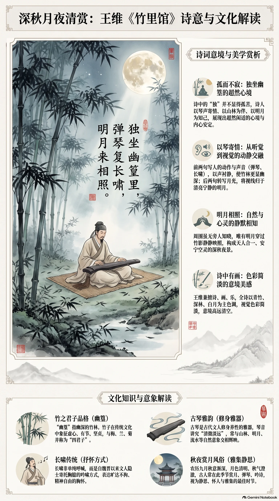

**唐代·王维** · 深秋月夜清赏

## 诗词全文

独坐幽篁里，弹琴复长啸。
深林人不知，明月来相照。

## 赏析

农历九月，秋意渐深，正适合读王维这首澄澈安静的小诗。诗人独坐幽深的竹林中，弹琴、长啸，自得其乐；周围没有旁人知晓，唯有明月穿过竹影，静静映照着他。“独”并不显得孤苦，因为诗人以琴声寄情、以山林为伴、以明月相知，呈现出超然闲适的心境。

全诗仅二十字，却层次丰富：前两句写人的动作和声音，琴声、啸声使寂静的竹林更显幽深；后两句转写月光，画面由听觉归于视觉，最终落在清亮宁静的“明月”上。王维兼擅诗、画、乐，此诗正有“诗中有画”的特色：青竹、深林、白月，色彩简淡而意境空灵。深秋夜晚读来，能让人暂时放下喧扰，在自然的清光中体会中国古典诗歌所珍视的内心安定与精神自由。

## 相关风俗

- 古人常在秋夜赏月、弹琴、吟诗。月色清明而秋气澄澈，被视为最适宜静思、怀人和雅集的时节。
- “幽篁”指幽深的竹林。竹在传统文化中象征虚心、有节、坚贞，与梅、兰、菊并称“四君子”。
- 古琴是古代文人修身养性的雅器。琴音讲究清微淡远，常与山林、明月、流水等意象相配。
- 长啸并非单纯呼喊，而是魏晋以来文人隐士寄托胸臆的一种吟啸方式，表现旷达不拘的精神气质。

## 背后的故事

> 《竹里馆》最耐人寻味处，不在“隐士偶坐”这一幅静景，而在它原属王维与裴迪唱和的《辋川集》：辋川并非荒山，而是蓝田别业中的可游、可居、可写诗之地。诗中无人相知、唯月相照，也不必坐实为失意；它更像一位兼具官员、诗人和奉佛居士身份者，刻意经营出的清寂时刻。

### 作者轶事

- 王维并不是终身避世的山人。他少年即以文艺知名，开元九年进士及第，仕途最高至尚书右丞，故后人称“王右丞”。然而传中又说他居常蔬食、晚年长斋，退朝后焚香独坐，以禅诵为事。读“独坐幽篁里”时，可看到的正是朝官身份与独处趣味并存，而非简单的穷困遁世。 〔史实 · 《新唐书·卷一二六·王维传》〕
- 王维的辋川生活有一位重要同游者裴迪。二人沿别业中的辋川、鹿柴、竹里馆等二十处景点各赋五绝，王维作一首，裴迪即和一首，合成《辋川集》。这种并非宴席大作、而像散步时彼此递答的写法，使《竹里馆》的短小并不显得孤绝；诗外原有友人应声，只是诗内有意写成“深林人不知”。 〔史实 · 《新唐书·卷一二六·王维传》〕

### 本事与创作背景

- 《竹里馆》是《辋川集》二十首之一。“馆”不是公共馆舍，而是别业园林中供憩息、读书或小住的建筑名。王维所得的辋川别墅，原为宋之问旧业，辋水环绕舍下；诗题所指，当是这一山居园林内以竹得名的一处小馆。四句所写，因而有具体地景作依托，并非纯然虚构的仙境。 〔史实 · 《新唐书·卷一二六·王维传》〕
- 题中与正文都没有落叶、霜、寒衣、候雁等物候字样，现存早期材料亦未标明季节。因此“深秋月夜清赏”可作为现代阅读时的布景，却不能当作作品本事。诗所能确证的是幽篁、琴声、长啸与明月；其时间气氛更接近一段被压缩到极静的夜间独处，而非有明确纪日的秋游记录。 〔史实 · 《王右丞集·辋川集》〕

### 时代背景

- 盛唐士大夫所谓“隐”，常不是与仕途彻底断绝。王维有蓝田别业，也长期出入朝廷；别业既可退居养病、奉亲与读佛，也可成为官僚文人经营山水审美的空间。于是“深林人不知”并非必定是政治放逐后的哀音，更可能是一种主动暂离人事、把感官交给竹影和月色的生活姿态。 〔史实 · 《新唐书·卷一二六·王维传》〕
- 唐代佛教语境深刻影响王维的日常与诗歌，但应避免把每一个“空”“独”字都硬释为禅机。史传所载的焚香、禅诵、长斋，足以说明他有浓厚奉佛生活；《竹里馆》却没有佛名、经语或寺院标记。它的高明之处正在于：静坐、无人、月照这些经验，可以让读者感到近禅的澄明，又仍只是可感可听的山居实景。 〔史实 · 《旧唐书·卷一九〇下·王维传》〕

### 风土人情

- “弹琴”在古代文人生活中并不只是表演节目。《礼记》说“君子无故不撤琴瑟”，把琴瑟视为修身、居处和礼乐秩序的一部分。放到竹馆月夜，琴声未必需要听众；它可以是独处时调息、遣怀的动作。王维紧接着写“复长啸”，一有弦音，一有人声，寂静便不是死寂，而是能容纳细微声响的深静。 〔史实 · 《礼记·曲礼下》〕
- 辋川在京畿蓝田，既近长安，又有山水可居，正适合唐人营置别业。此类别业并非单纯农庄：可设馆、亭、柴门与小径，主人和宾客按景命名、分题赋诗，将私人地产组织成可游览的文学地图。《辋川集》的二十题正保留了这种空间使用方式；“竹里馆”是园林地名，也是诗歌中可反复进入的一间小小舞台。 〔史实 · 《新唐书·卷一二六·王维传》〕

### 典故与名物

- “幽篁”即幽深的竹丛。“篁”在先秦两汉文学中已是竹林的雅称，《楚辞·山鬼》有“余处幽篁兮终不见天”。王维未必是在逐字用典，但这一词自带古典山林的幽暗纵深：不是庭前几竿新竹，而是遮蔽天光、足以隔绝人迹的密林。故首句的“独坐”有了空间上的依据，末句明月的到来才格外醒目。 〔史实 · 《楚辞·九歌·山鬼》〕
- “长啸”是拉长声音的呼啸，在魏晋人物故事中常带有超脱、任性的色彩。《世说新语》记阮籍往见孙登，退而长啸，山谷为之传响；后世读者也易联想到伯牙鼓琴而待知音的故事。不过王维诗中没有孙登、知音等明指，不能断言他专用阮籍或伯牙典；琴而无人、月来相照，更像借这些文化记忆反衬不求知音的自足。 〔存疑 · 《世说新语·栖逸》〕
