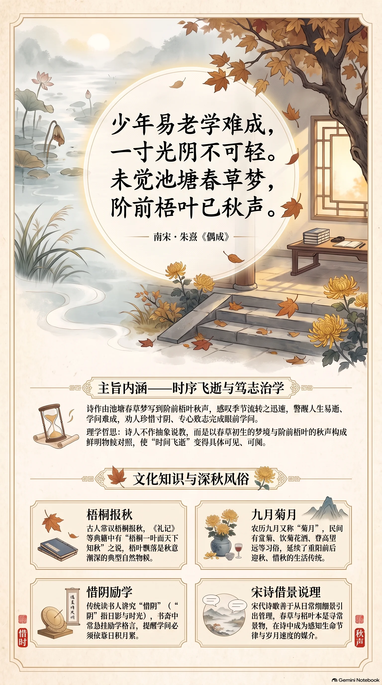

**南宋·朱熹** · 深秋惜时

## 诗词全文

少年易老学难成，一寸光阴不可轻。
未觉池塘春草梦，阶前梧叶已秋声。

## 赏析

这首诗写在不经意间感到季节流转，由秋声而警醒人生易逝、学问难成。前两句直陈道理：人的少年时光很快过去，而学问的积累却十分艰难，因此每一寸光阴都不可轻易放过。后两句写得尤其生动：仿佛池塘边春草初生的梦境还未醒来，台阶前的梧桐叶已在秋风中发出萧瑟声响。诗人不用抽象说教，而以春草、梧叶构成鲜明的时序对照，让“时间飞逝”变得可见、可闻。农历九月正值深秋，梧桐落叶、晨晚渐凉，读此诗既能感受古人敏锐的物候观察，也能体会理学家朱熹对治学的朴素要求。它并非催人焦虑，而是提醒人在清朗秋日里珍惜当下，专心完成眼前值得投入的事。

## 相关风俗

- 古人常以梧桐报秋。《礼记》等典籍中已有“梧桐一叶而天下知秋”的说法，梧叶飘落遂成为秋意渐深的典型物候。
- 农历九月又称“菊月”，民间有赏菊、饮菊花酒、登高望远等习俗，延续了重阳前后迎秋、惜秋的生活传统。
- 传统读书人讲究“惜阴”，阴本指日影，后代指时光。书斋中常悬励学格言，以提醒学问须靠日积月累。
- 宋代诗歌善于从日常细景引出哲理。春草与梧叶本是寻常景物，在诗中却成为感知生命节律与岁月速度的媒介。

## 背后的故事

> 这首绝句最耐人寻味处，不在泛说勤学，而在把谢灵运“池塘生春草”的灵感梦境，压缩为“未觉”二字；庭阶梧叶一响，青春已被推到秋天。它传为朱熹诗集所收，却无明确作年，正适合从宋代理学的日课、书院规约与古人惜阴传统中读出其紧迫感。

### 作者轶事

- 朱熹生于建炎四年，十四岁时父朱松去世。朱松本因不附和秦桧而被罢官，临终又令其从胡宪、刘勉之、刘子翚等人游学。少年朱熹的求学，并非安坐家塾的闲适生活，而带着家学、师承与时代风波留下的紧迫感；“少年易老”放在这样的身世中，格外像自警。 〔史实 · 《宋史·卷四二九·朱熹传》〕
- 朱熹十八岁即中绍兴十八年进士，后初任泉州同安县主簿；仕途起步不算迟，却始终把读书视作终身工夫，而非科举及第即可封卷。他一生讲学、著述、校订经传，反复强调由博学、审问到笃行的次第。这种对“学难成”的体认，来自长期实践，不只是劝少年人的套话。 〔史实 · 《宋史·卷四二九·朱熹传》〕

### 本事与创作背景

- 今传《偶成》为七言绝句，收入朱熹诗作汇编，题目意为偶然触景而成，并没有序文、跋语或赠答对象可供追索。因此不能坐实为朱熹在某一书院、某次秋游或专为劝诫弟子所作。所谓“深秋惜时”，主要应视为由诗中梧叶秋声推得的抒情场景，而非可考的行迹。 〔史实 · 《朱子全书·卷四》〕
- 全诗的结构不是平铺训诫：前二句说“学难成”与“光阴不可轻”，后两句忽由池塘春草转到阶前秋叶，以“未觉”对“已”，把抽象的岁月流逝写成感官上的错愕。春梦本应柔和，秋声却从台阶前逼近，故其语气既像劝学，也有中年人回望少年时光的微凉。 〔史实 · 《朱子全书·卷四》〕

### 时代背景

- 南宋士人的“为学”不只是准备科举，也逐渐成为理学共同体的日常修养语言。朱熹主持白鹿洞书院时，将“博学、审问、慎思、明辨、笃行”列为为学之序，又以修身、处事、接物相贯通。于是“一寸光阴不可轻”并非单指赶考，而是把每一天都纳入不断检点德业的工夫。 〔史实 · 《朱文公文集·卷七十四·白鹿洞书院揭示》〕

### 风土人情

- 宋代书院与家塾中的读书生活，重在持久的日课，而不只临考突击。白鹿洞的规约将问学、思辨、力行并列，并要求人在父子、君臣、夫妇、长幼、朋友等日用伦常中践履。读此诗可想见一种具体的书斋节律：晨昏课读之间，庭院草木照常荣枯，人的学业却须日日自省，不能听任季节替自己翻页。 〔史实 · 《朱文公文集·卷七十四·白鹿洞书院揭示》〕

### 典故与名物

- “一寸光阴”承接古代“惜阴”说。所谓“阴”，本指日影；《淮南子》说圣人不以一尺美玉为贵，却看重一寸日影，因为时间难得而易失。朱熹把典雅的“寸阴”置于“不可轻”之后，便将书生窗下的片刻光线，写成比珍玉更不可挥霍的东西。 〔史实 · 《淮南子·原道训》〕
- “池塘春草梦”最直接地牵出谢灵运故事。谢灵运作诗苦思不得，梦见族弟谢惠连后，便写成“池塘生春草”，自称此句如有神助，非全由自己意匠而得。朱熹不直引原句，而说“未觉池塘春草梦”，将诗人偶得佳句的春日梦境化为人生尚未醒悟、年华已迅速迁移的象征。 〔史实 · 《南史·卷一九·谢灵运传》〕
- “梧叶已秋声”未必专指某一固定典故，却接近古人由一叶知岁暮的观察传统。《淮南子》称见一叶落，便知岁将暮；朱熹又特拈庭前梧桐，使无形的秋意变成可听见的叶声。应注意，典籍原文只说“一叶”，并未限定梧桐；后世“一叶知秋”的成语化说法，不宜倒当作诗句的唯一出处。 〔史实 · 《淮南子·说山训》〕
