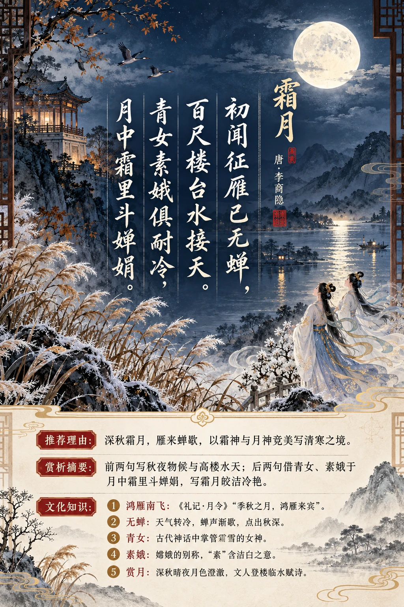

**唐·李商隐** · 深秋霜月

## 诗词全文

初闻征雁已无蝉，百尺楼台水接天。
青女素娥俱耐冷，月中霜里斗婵娟。

## 赏析

农历九月已是深秋，候鸟南飞、寒蝉声歇，正与诗中“征雁”“无蝉”的清冷物候相应。前两句从听觉和视觉写秋夜：刚听到大雁南迁，蝉鸣便已沉寂；登上高楼，只见水天相接，月色澄澈而辽阔。“初闻”与“已无”形成时间上的呼应，点出季节由凉入寒的迅速转换。

后两句不直说人间寒意，却把神话中的青女与嫦娥写入月霜之间。青女是主管霜雪的女神，素娥即月中嫦娥；她们都能忍受清寒，并在月光与秋霜中比美。“斗婵娟”并非单纯写美貌，而是借两位仙子衬托霜月的皎洁、冷艳与超尘。诗人将萧瑟的深秋写得空灵华美：寒意并不压迫，反而因月色与想象而显出一种高洁的光彩。短短四句，融入物候、楼景与神话，适合在秋夜静读，体会古人面对清寒时的审美心境。

## 相关风俗

- 古人将鸿雁南飞视为深秋的重要物候。《礼记·月令》记有“季秋之月，鸿雁来宾”，雁群常被用来寄托时序变迁与羁旅乡思。
- “无蝉”点出秋深。蝉多在夏秋鸣叫，天气转冷后声息渐歇；古诗常以蝉声的有无表现季节推进和环境的幽静。
- 青女是中国古代神话中掌管霜雪的女神。她与秋霜相连，诗文中常用“青女”代称霜天或深秋的清寒景象。
- “素娥”是嫦娥的别称。“素”含洁白之意，适合形容月中仙子的清丽，也使月光、白霜与人物意象彼此映照。
- 赏月是秋季重要的传统雅事。除中秋外，深秋晴夜的月色往往更显澄澈，文人常登楼、临水、饮酒或赋诗以观月。

## 背后的故事

> 《霜月》最耐人寻味处，在于它并不铺写寒夜的孤寂，而把霜神青女与月中素娥写成相互竞美的冷艳人物。雁来、蝉歇本是《月令》式的物候次序，经李商隐一转，百尺楼台、水天月色遂成为两位神女争辉的舞台。

### 作者轶事

- 李商隐少年孤贫，凭文才投谒天平军节度使令狐楚。令狐楚赏识他，使其学习骈体章奏；李商隐后来写表启书牍极为娴熟，和这段幕府训练有关。诗人一生常以绮丽近乎神秘的意象写人写景，并非单纯的风流姿态，也带着早年依人门下、求进无门的敏感与曲折。 〔史实 · 《新唐书·卷二百三·文艺下·李商隐传》〕
- 令狐楚死后，李商隐又受泾原节度使王茂元赏识，并娶王氏女。王茂元被目为李德裕一派人物，令狐氏则与牛僧孺、李宗闵集团关系密切；李商隐因婚姻和仕途牵连，受到令狐绹猜忌。后人常从这种夹缝处境理解其诗的幽约含混，但不能把每一首写月诗都硬解为党争寓言。 〔史实 · 《新唐书·卷二百三·文艺下·李商隐传》〕

### 本事与创作背景

- 《霜月》收入李商隐诗集时只有题目和四句正文，未标作地、赠答对象或写作缘起。它可确定为一首七言绝句，却不能确证是登楼实景、应酬题咏，还是纯粹的秋夜构思。“百尺楼台水接天”宜先当作高楼临水、天地相涵的诗境，而不宜贸指为某一座现存楼阁。 〔史实 · 《全唐诗·卷五百三十九》〕

### 时代背景

- 李商隐所处的晚唐，进士登第、幕府辟署与权贵援引紧密相连，牛李党争又使士人的门第交游格外敏感。他屡试、入幕、出任小官，仕途并不显达。此种时代压力确实构成其诗歌的底色；但《霜月》没有官名、时政或寄赠线索，它更像把现实中难言的清冷，转化为神女、霜月和楼台的审美秩序。 〔史实 · 《旧唐书·卷一百九十下·文苑下·李商隐传》〕

### 风土人情

- “初闻征雁已无蝉”压缩了古人用物候标记秋深的经验。《礼记·月令》说孟秋有“凉风至，白露降，寒蝉鸣”，仲秋则“鸿雁来”。诗句故意将“雁来”与“蝉歇”并置：耳中先是夏末残蝉，继而换作北雁南征，读者不必知道日期，已能感到季节从清响转为寥阔。 〔史实 · 《礼记·月令》〕

### 民间传说与后世演绎

- 月中美人的母题，背后是后羿、姮娥的升月神话。《淮南子》说后羿向西王母求得不死药，姮娥盗食后奔入月中；后世文学中常以嫦娥、月姊、素娥等名目铺写月宫。李商隐此诗不直称嫦娥，却以“素娥”承接这一想象，使月亮不只是天体，而带有清寒、自守而又绝艳的女性人格。 〔传说 · 《淮南子·览冥训》〕

### 典故与名物

- “青女”是古代神话中的霜雪之神。《淮南子·天文训》称秋季地气凝结，“青女乃出，以降霜雪”。因此“青女”不是一位可考的历史女子，而是霜的拟人化。李商隐让她与月中素娥并列：一位主管霜，一位居于月，二者都“耐冷”，正好把深秋夜色化作两种寒光的较量。 〔传说 · 《淮南子·天文训》〕
- “素娥”即月中女神的雅称。《文选》所收谢庄《月赋》已有“集素娥于后庭”之语，李善注释明言素娥为月神。句末“斗婵娟”的“婵娟”本指女子姿态美好，《说文解字》释“嬋”为“嬋娟，态也”；在这里不是说霜月真的争斗，而是说霜神与月神各以冷艳姿容竞胜。 〔史实 · 《文选·卷十三·谢庄〈月赋〉》〕
