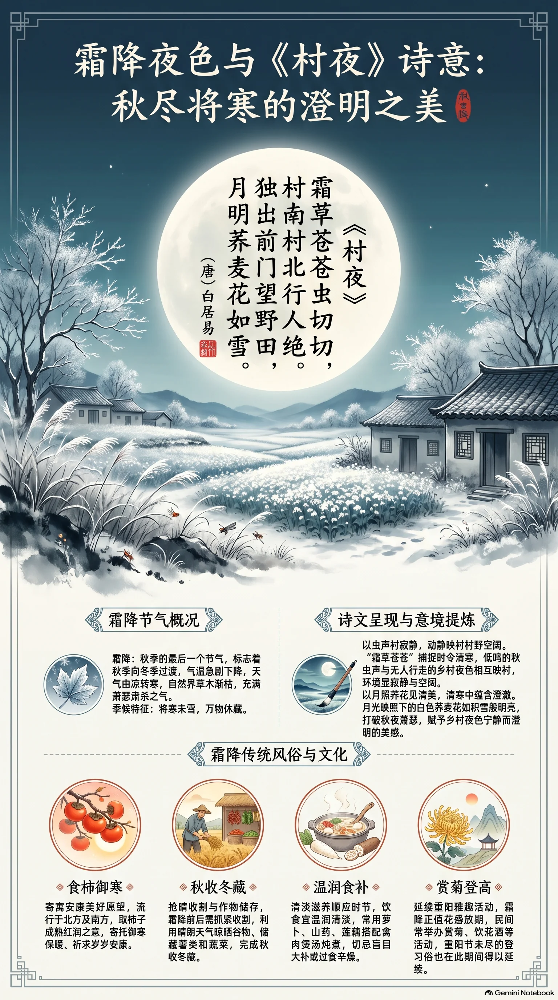

**唐·白居易** · 霜降

## 诗词全文

霜草苍苍虫切切，村南村北行人绝。
独出前门望野田，月明荞麦花如雪。

## 赏析

霜降是秋季最后一个节气，天气由凉转寒，草木渐枯，田野也进入收获与休藏的时节。白居易《村夜》虽非专为霜降而作，却以“霜草苍苍”开篇，准确捕捉了这一时令的清寒底色。“虫切切”写秋虫低鸣，与“行人绝”的村野寂静相互映衬，听觉越细，环境越显空阔冷清。后两句由近处的霜草、虫声转向远处的野田和明月，诗人独自出门，忽见荞麦花在月光下白如积雪。这里的“雪”并非真雪，而是月色映照白花所生的错觉，既照应霜降将寒未雪的季候，也使萧瑟秋夜生出澄澈、宁静的美感。全诗语言平易，景物寻常，却通过冷暖、动静、近远的层次变化，把乡村秋夜的孤清与明丽融为一体，提醒人们在季节转换时留意自然细微而动人的光景。

## 相关风俗

- 民间有霜降食柿的习惯，尤其流行于北方及部分南方地区，取柿子成熟、色泽红润之意，也寄寓御寒安康的愿望。
- 霜降前后宜抓紧收割晚熟作物，并晾晒谷物、储藏薯类和蔬菜；晴朗干燥的天气尤其适合完成“秋收冬藏”。
- 不少地区会在此时煲汤进补，如以萝卜、山药、莲藕配禽肉炖煮，饮食宜温润清淡，避免盲目大补或过食辛燥。
- 霜降正值菊花盛放期，民间有赏菊、饮菊花酒等雅俗活动；重阳前后未尽的登高习俗，也常延续到这一时段。

## 背后的故事

> 这首小诗最耐人寻味处，在于它并不把“霜降”写成节令图谱：霜草已白、行人已绝，偏偏尚有“虫切切”的残声；待诗人独自推门，声音又让位于月光下大片荞麦花。所谓村夜，不是热闹的田家乐，而是秋令将尽、生命仍微微颤动的一瞬。白居易早年任县尉时对乡村劳作的观察，也使这幅画面不止于清丽。

### 作者轶事

- 白居易并非只在书斋中想象村景。元和初年他曾任盩厔县尉，亲见关中农家的收获与劳苦。《观刈麦》自序明言“时为盩厔县尉”，诗中有“足蒸暑土气，背灼炎天光”的近距离描摹。《村夜》虽无明言政事，诗人独立门前、凝望野田的姿态，仍带着这位地方小官长期观察乡村的眼光。 〔史实 · 《旧唐书·卷一百六十六·白居易传》；《白居易集·观刈麦》〕

### 本事与创作背景

- 《村夜》题目极简，既无赠答对象，也没有序、引或自注交代事件。它不像白居易许多讽谕诗那样有明确“本事”，更接近一次偶然的夜行凝望：前两句先听见霜草间虫声、看见道路断绝，后两句才写诗人“独出前门”。写作的触发点，应是秋夜出门所见的月色与荞麦花，而非可考的宴集、送别或政治事件。 〔史实 · 《全唐诗·卷四百三十六》〕
- 关于“渭村”与成诗年代，后世编年多把此诗置于元和六年秋。这个判断大抵依据白居易当时诗作的编排及其在关中居住、出入的行迹，而不是一条可直接核验的诗人自记。因此，写作时不妨把它设想为京畿近郊的一次晚秋夜望，却不宜进一步坐实为某一村庄、某一夜或某位主人家的故事。 〔存疑〕

### 时代背景

- 唐代县尉是县级属官，职责涉及缉捕、治安及协助地方政务；白居易早年担任此职，活动范围本就不离村落、道路与田亩。理解这一制度背景，可避免把“村南村北行人绝”径直读成乱世惨象：它首先是霜夜乡道的实景，也是熟悉地方生活的观察者所捕捉到的、从人事归寂转向自然显影的时刻。 〔史实 · 《唐六典·卷三十》；《旧唐书·卷一百六十六·白居易传》〕

### 风土人情

- “霜降”在古代并不只是后来日历上固定的一格，而是观察物候、安排农事的节点。《逸周书·时训解》记“霜降之日，豺乃祭兽；又五日，草木黄落；又五日，蛰虫咸俯”。诗中霜草已呈苍白，虫声却还“切切”，正写在昆虫将蛰未蛰的临界处：地面看似冷寂，草根间仍有最后一点生命声响。 〔史实 · 《逸周书·时训解》〕
- 荞麦是耐瘠薄、成熟较晚的杂粮，在北方山地与旱地尤常见。李时珍说它“八九月开白花”，正与诗中霜夜、明月相合。荞麦花并非真正积雪，细小白花成片铺开，在月下会失去枝叶层次，只剩一片冷亮的白；“花如雪”因此既是比喻，也是乡村夜色中很准确的视觉经验。 〔史实 · 《本草纲目·谷部·荞麦》〕

### 典故与名物

- “苍苍”容易使人想到《诗经·秦风·蒹葭》“蒹葭苍苍”，而“如雪”又承接古典诗歌常以白色写秋景、月景的传统；但《村夜》并没有能够证明其直接化用的字句。更稳妥的读法，是把“霜草苍苍”视为颜色、寒意与暮夜共同造成的感官铺陈，而非强指某一篇章为典故来源。其妙处正在不露书卷痕迹。 〔存疑〕
