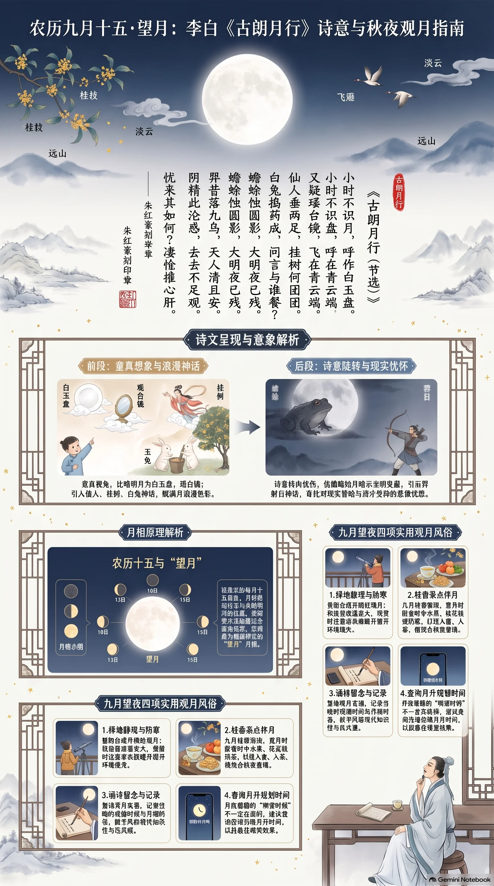

**唐代·李白** · 农历九月十五·望月

## 诗词全文

小时不识月，呼作白玉盘。
又疑瑶台镜，飞在青云端。
仙人垂两足，桂树何团团。
白兔捣药成，问言与谁餐？
蟾蜍蚀圆影，大明夜已残。
羿昔落九乌，天人清且安。
阴精此沦惑，去去不足观。
忧来其如何？凄怆摧心肝。

## 赏析

农历每月十五前后，月亮运行至与太阳相对的位置，夜间所见月面最为圆满明亮，正是传统“望月”的好时节。李白《古朗月行》以孩童的想象开篇，把明月比作“白玉盘”“瑶台镜”，语言天然明丽，极富童真；继而写月中仙人、桂树、玉兔，融会神话传说，使高悬天际的月亮充满浪漫色彩。诗意随后陡转，“蟾蜍蚀圆影”借月食传说暗示光明受蔽，并联想到后羿射日的神话，寄寓诗人对现实昏暗、贤才受抑的忧思。今天虽非中秋，却逢九月望日，秋夜天高气清，适宜循着诗句观月：既欣赏月色的澄澈圆满，也感受李白由天真幻想转入深沉忧怀的情感层次。诗中月亮不只是自然景物，更是想象、神话与人生感慨交汇的象征。

## 相关风俗

- 望日夜可在阳台或开阔处赏月，秋季昼夜温差较大，宜添衣并避开强光，静观月面明暗纹理。
- 可与家人共食时令水果、桂花糕或热茶。九月桂香渐浓，以桂入食、入茶很契合秋夜月色。
- 古人赏月常配诗酒与清谈；今人可朗诵写月诗词，记录月相和观测时间，增添仪式感与知识性。
- 月圆并不意味着每月朔望时刻都在夜间；若想看得更圆更亮，可查询当地当晚的月升时间再安排观赏。

## 背后的故事

> 《古朗月行》最耐人寻味处，在于它以儿童仰望“白玉盘”的天真开篇，却迅速滑入蟾蜍蚀月、后羿射日的阴影。月亮不再只是清景，而成为仙药、谪仙、灾异与政治忧思交叠的银幕。尤其“桂树”“白兔”“蟾蜍”三种月中形象，实出自不同时代的神话层累，后世常将它们误读为同一套完整传说。

### 作者轶事

- 李白并非只是一位闭门观月的诗人。《新唐书》概括他“喜纵横术，击剑，为任侠，轻财好施”，其早年游侠、漫游和求仕的经历，使他笔下的神仙世界常带有行动感：后羿能挽弓落日，仙人能临空垂足，月宫也不是静物，而是充满人物、刑罚与变故的场所。 〔史实 · 《新唐书·李白传》〕
- 天宝初年，李白曾被玄宗召入长安，供奉翰林，旋即“赐金放还”。这段短暂的宫廷经历，令后世读者尤其容易把诗末“阴精此沦惑，去去不足观”的失望，联系到他对朝廷与理想政治的幻灭。不过就此诗而言，不能仅凭情绪便断定它写于被放还之后。 〔史实 · 《新唐书·李白传》〕

### 本事与创作背景

- “朗月行”本是乐府旧题，李白题作“古朗月行”，并非一篇可确定写给某位友人的即席咏月诗。乐府旧题容许诗人沿用古老声调和母题而自出新意：前半模拟童稚惊奇，后半忽转天象灾变与忧心摧折，正是借旧题扩张为寓言式长歌。 〔史实 · 《乐府诗集·卷六十六·杂曲歌辞六》〕
- 诗中“小时不识月”常被当作李白自叙，实际上没有可靠史料证明他幼时确曾把月亮叫作“白玉盘”。它更像乐府口吻中的角色设定：先以孩子的误认制造圆、白、明的视觉印象，再让成人知识中的仙人、兔药、蟾蜍逐层覆盖这份天真。 〔存疑〕

### 时代背景

- 唐玄宗朝崇奉道教，朝廷尊老子为玄元皇帝，置庙加号；神仙、服食、月宫等意象既在宫廷礼制中受重视，也广泛进入诗歌语言。李白写“瑶台”“仙人”“捣药”，并不只是童话式装饰，而是借当时读者熟悉的仙道想象，反衬月色竟被“蟾蜍”侵蚀的失序。 〔史实 · 《旧唐书·玄宗本纪上》〕
- “羿昔落九乌，天人清且安”把明月的残缺同治世的缺失并置：神话中的羿除去十日，恢复人间秩序；眼前的“阴精”却沉沦迷惑，无人能救。历代注家多倾向将末段读作政治寄托，但究竟讽刺女宠、奸佞、君权昏蔽，还是泛指理想破灭，文本没有给出可核实的专指。 〔存疑〕

### 风土人情

- 题设所定农历九月十五，确是“望日”，适合以满月为观赏中心；但它不是通常意义上的中秋。传统节俗中，“中秋”特指八月十五，宋代汴京已有登楼玩月、富家结饰台榭、民间争占酒楼的热闹景象。李白此诗本身未点明月份，不能把它直接说成一首中秋节诗。 〔史实 · 《东京梦华录·卷八·中秋》〕

### 民间传说与后世演绎

- 今人说到“月中桂树”，往往立刻想到吴刚伐桂；但吴刚故事并非此诗明说的内容。唐人笔记称月桂高五百丈，西河人吴刚因学仙有过，被谪令常伐此树，而树伤随合。李白只写“桂树何团团”，重点仍是月面纹影宛如一株浑圆大树，未写斫桂的循环苦役。 〔传说 · 《酉阳杂俎·卷一·天咫》〕
- 李白后来也被月亮神话反过来包围。元代《唐才子传》记他在采石矶酒后泛舟，“欲捉月影，遂沉水中”，形成“捉月而死”的著名传说。它与《古朗月行》的月中仙境极相配合，却与较早史传所记的李白卒于当涂说法不能完全相合，应作为文学化身后传说来使用。 〔传说 · 《唐才子传·卷二》〕

### 典故与名物

- “白兔捣药成，问言与谁餐”承接的是月兔神话。《楚辞·天问》已有“顾菟在腹”之问，东汉王逸注说“顾菟，兔也”，明确把兔置于月中。兔为何捣药，则与求不死、服仙药的观念相连；李白故意追问药成给谁吃，使长生传说显出无人受益的荒凉。 〔史实 · 《楚辞·天问》〕
- “蟾蜍蚀圆影”不是在记录一次真实月食，而是调动古人对月中蟾蜍的想象。张衡《灵宪》叙羿向西王母求不死药、姮娥窃药奔月，终于“托身于月，是为蟾蜍”。因此蟾蜍既是月面阴影的解释，也带着偷药、变形和月光亏损的阴冷意味。 〔史实 · 《太平御览·卷四·天部四》〕
- “羿昔落九乌”用的是十日并出的神话。尧时十日齐出，禾稼焦枯、百姓无食，尧命羿上射十日，留下一个日轮。诗中以“九乌”概括被射落的九日；羿的武功不只是炫奇，而是灾后重建“天人清且安”的秩序模型，正好映照末尾无可挽回的忧惧。 〔史实 · 《淮南子·览冥训》〕
