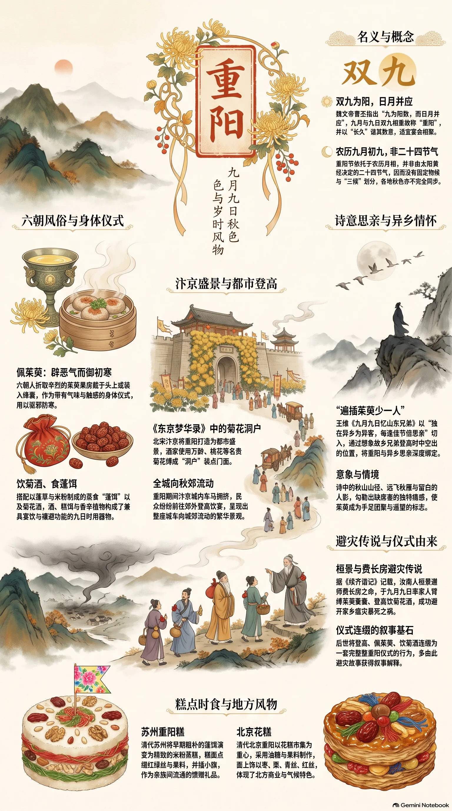

**汉族节日** · 2026-10-18（丙午年，九月初九）

## 节令素材

> 重阳最耐写的，不只是“登高赏菊”，而是一个由阴阳数术、避灾叙事和城市游乐共同织成的日子。六朝人插茱萸、饮菊酒以避初寒与邪气；北宋汴京则把菊花扎成酒楼门洞，令全城登高；陶潜在菊丛间等到王弘送酒的故事，又使此日染上清贫而有骨的文人颜色。

### 名义与物候

- 重阳定在农历九月初九，并非二十四节气，因而没有太阳黄经的定点，也没有“三候”物候。魏文帝曹丕写给钟繇的信已解释其得名：“九为阳数，而日月并应”，九月与九日双九相重，故称“重阳”；又以“长久”谐其数意，适宜宴会相聚。 〔史实 · 《艺文类聚》卷四·岁时中，引魏文帝曹丕《与钟繇书》〕
- 重阳虽常被纳入秋令书写，却应与节气分开处理：《月令七十二候集解》所列节气、物候中没有重阳；六朝岁时书则直接以“九月九日”为节日条目。它的时间感来自月相与农历，而非寒露、霜降之间某一固定的天文瞬间，这使各地秋色并不同步。 〔史实 · 《月令七十二候集解》；《荆楚岁时记》〕

### 历代风俗

- 梁代荆楚地区的九日，已是“并籍野饮宴”的公共出游日。人们折取茱萸果房插在头上，认为可以“辟恶气而御初寒”；这不是后世抽象的登高符号，而是带有气味、触感与季节焦虑的身体仪式：鬓边插一枝辛烈的茱萸，扶老携幼到郊野饮酒。 〔史实 · 《荆楚岁时记》〕
- 北宋汴京把重阳经营成都市盛景。《东京梦华录》记九月菊花有万龄、桃花、木香、喜容等名目，酒家还用菊花缚成“洞户”装点门面；城中人多往郊外登高，席间饮宴。可写成一座暂时向秋郊流动的城市：店门先被花围成洞，车马与人群随后涌出城去。 〔史实 · 《东京梦华录》卷八·九月重阳〕

### 饮食与器物

- 菊花酒与茱萸不是静物摆设。六朝岁时记将“佩茱萸、食蓬饵、饮菊花酒”并列：蓬饵是以蓬草和米粉制成、蒸食的时令饵食；茱萸则常被折作佩插之物。酒、糕饵、香辛植物构成一套入口、佩身、随行的九日器用，兼具宴饮和禳避意味。 〔史实 · 《荆楚岁时记》〕
- 苏州一带清代所食的重阳糕，已将早期“蓬饵”的粗朴形象换成精致的米粉蒸糕。《清嘉录》记九日家家以糕相馈，并讲究在糕面点缀红绿丝、果料，或插小旗。糕的层叠形制容易被解释为“高”，但在日常生活里，它首先是节日前后在市肆、亲族间流通的馈赠食品。 〔史实 · 《清嘉录》卷九·重阳〕

### 诗文中的它

- 王维《九月九日忆山东兄弟》把节日写成缺席者的痛感：“独在异乡为异客，每逢佳节倍思亲。”末句“遍插茱萸少一人”尤其巧：诗人不正面写自己登高，而是想象故乡兄弟插满茱萸时，队列中空出的一个位置。自此，重阳在诗中常与异乡、手足和遥望绑定。 〔史实 · 《全唐诗》卷一百二十八·王维《九月九日忆山东兄弟》〕
- 杜牧《九日齐山登高》却把重阳从思亲转为临江高会。“江涵秋影雁初飞，与客携壶上翠微”先给出雁影、江色、酒壶和山径，末以“尘世难逢开口笑，菊花须插满头归”作豪放自劝。茱萸在王维诗中是亲人团聚的标记，到杜牧笔下已可由菊花替代，成为及时行乐的冠饰。 〔史实 · 《全唐诗》卷五百二十三·杜牧《九日齐山登高》〕

### 人物与传说

- 桓景与费长房是重阳避灾传说中最具体的一对师徒。《续齐谐记》说汝南人桓景随方士费长房学道，长房预言九月九日家乡将有灾，令其家人缚茱萸囊于臂、登高饮菊花酒；归来见鸡犬牛羊暴死，众人因而免祸。后世将登高、茱萸、菊酒连缀为一套九日仪式，多由此故事获得叙事解释。 〔传说 · 《续齐谐记》；《荆楚岁时记》引述〕
- 陶潜使重阳又有了另一种人物光影。《宋书》称他九月九日坐在宅边菊丛中，久而久之，手中只把玩菊花；恰逢江州刺史王弘遣人送酒，他便就地开饮，醉后而归。这里没有驱邪和灾厄，只有穷居者、野菊与迟到的酒：重阳因此可写成清寒中忽然得到的一点人情。 〔史实 · 《宋书》卷九十三·隐逸传·陶潜〕

### 方志记载

- 岭南的重阳，山不是背景而是节日的主角。屈大均记广州人九日多登白云山，士女结伴而往，山上游人、酒食与香火相杂。与中原重阳多取“登高避灾”的叙事不同，广州近城有可登的白云山，节日因而发展为规模可观的城郊游行；岭南湿热而秋意迟，也使九日更像一次集体寻秋。 〔史实 · 《广东新语》卷七·人语·重阳〕
- 清代北京的九日习俗，重心更偏向糕点市集。《燕京岁时记》记京师重阳食花糕，糕有油糖、果料等不同做法，并以枣、栗、青丝、红丝等作面上装饰。南方笔记里的菊酒与山行，到北方城内转化为可携、可买、可赠的“花糕”；同一重阳，在气候与都市商业中呈现出不同的质地。 〔史实 · 《燕京岁时记·九月九日》〕
