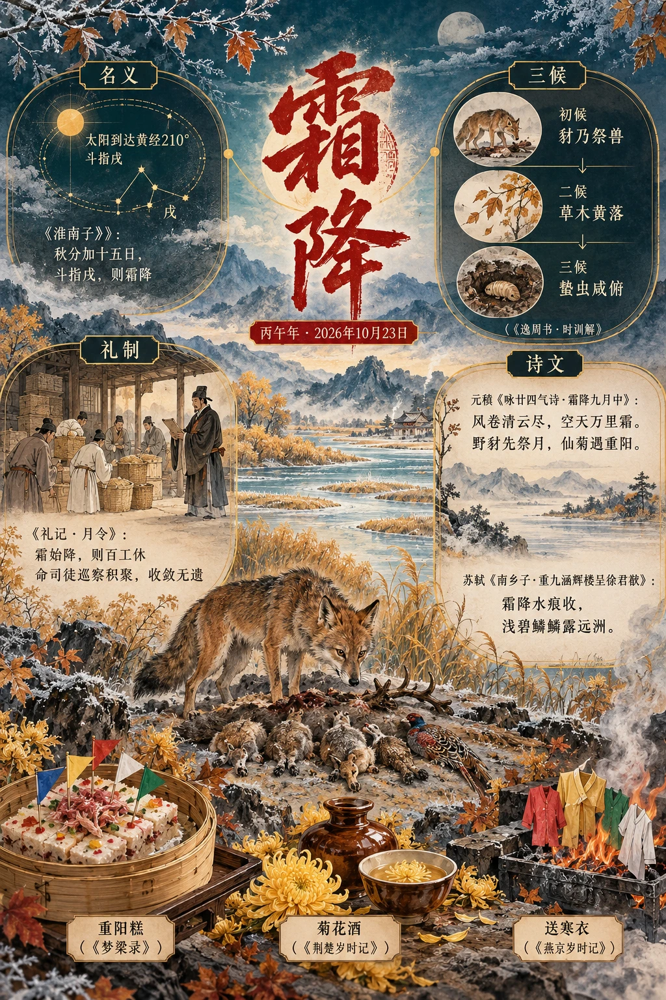

**节气** · 2026-10-23（丙午年，秋季）

## 节令素材

> 霜降最适合写成一幅由明转暗的秋末图景：三候里豺獭陈兽、草木黄落、蛰虫俯藏；礼制中百工停歇、官府督促收藏；城中却仍以菊酒、蒸糕和登高收束重阳余兴。它不是“下霜”的单一瞬间，而是人、兽、草木一同撤入冬藏秩序的门槛。

### 名义与物候

- 霜降是太阳到达黄经二百一十度的节气，通常在公历十月二十三日前后；2026年即在10月23日。古人以北斗斗柄指戌定其时，《淮南子》说“秋分加十五日，斗指戌，则霜降”，其名称本指阴气凝结、草木见霜的物候，并不保证当日各地必有霜。 〔史实 · 《淮南子·天文训》；《中国天文年历》2026年〕
- 《逸周书》将霜降十五日拆为三候：初候“豺乃祭兽”，豺捕得禽兽而陈列如祭；五日后“草木黄落”；再五日“蛰虫咸俯”。这套次序很适合铺陈由猎食、凋零到潜藏的递暗镜头，亦显示节气原本是一套观察生物活动的历法语言。 〔史实 · 《逸周书·时训解》〕

### 历代风俗

- 《礼记·月令》把霜降置于季秋政令中：霜始降，便“百工休”；天子命司徒巡察积聚，务令收敛无遗，又命水虞、渔师收取池泽之赋。写作时可见库藏、渔网、停下的工场与忽然增添的皮裘；这是国家以“藏”为核心来组织深秋的样子。 〔史实 · 《礼记·月令》〕
- 北宋汴京的霜降前后仍在重阳的热闹里。《东京梦华录》写九月九日，市中以菊花缚成洞户，豪贵之家以菊花装饰楼台、车轿，士庶出城登高；酒家以菊花入酒相待。菊不只是案头清供，而是街市门洞、车马与酒旗共同构成的季秋舞台。 〔史实 · 《东京梦华录·卷八·重阳》〕

### 饮食与器物

- 六朝荆楚人在九月九日“佩茱萸，食蓬饵，饮菊花酒”。霜降常与重阳相接，蓬饵与菊酒遂可作为此时令的旧味。尤其“饮菊花酒”不是泛称赏菊：它把可佩的药草、可饮的花与登高野宴连成一套身体仪式，杯中有迟暮秋色的苦香。 〔史实 · 《荆楚岁时记·九月九日》〕
- 南宋临安九月制作“重阳糕”，《梦粱录》记其以糖面蒸成，糕面铺猪、羊肉和鸭肉细丝，并插小彩旗。它并非后来单色甜糕的简略印象：蒸汽、肉丝、糖面和彩旗同时出现，适合写成霜降时节市肆窗口里一件富丽而短暂的节令食物。 〔史实 · 《梦粱录·卷五·九月》〕

### 诗文中的它

- 元稹《咏廿四气诗·霜降九月中》开篇即写“风卷清云尽，空天万里霜”，继而接“野豺先祭月，仙菊遇重阳”。诗人没有停在白霜本身，而把三候中的豺祭、节日中的菊花并置：天空被风清空，地上则有兽与人各自举行秋末仪礼。 〔史实 · 《全唐诗·卷四〇一·咏廿四气诗·霜降九月中》〕
- 苏轼重九登黄州涵辉楼，起句为“霜降水痕收，浅碧鳞鳞露远洲”。“霜降”在词中不是天象说明，而是江水退痕、沙洲显露的视觉动词；下片写“破帽多情却恋头”，又以醉后风软收束。可借其笔法写秋深的空阔与士人自嘲，而不必直写寒冷。 〔史实 · 《东坡乐府·南乡子·重九涵辉楼呈徐君猷》〕

### 人物与传说

- 霜有一位古老的女性神祇“青女”。《淮南子》称秋季三月“青女乃出，以降霜雪”；后世诗文遂常以“青女”代霜，如同以玄冥写冬威。她没有完整的民间情节，却极适合文学化呈现：一位不现身的秋神过境，留下白色印记，草木便开始转黄、俯伏。 〔传说 · 《淮南子·天文训》〕

### 方志记载

- 北京地区把霜降后的阴冷落实为“送寒衣”。《燕京岁时记》记十月朔为“十月朝”，人家祭祖上坟，剪五色纸作衣，于门外焚化，称送寒衣。此日按农历而非固定落在霜降，却常紧邻其后；纸衣的灰烬与初霜一道，使季秋多出亡者也需御寒的想象。 〔史实 · 《燕京岁时记·十月》〕
- 苏州的《清嘉录》亦记十月朔“送寒衣”之俗：民间以彩纸制衣、鞋、帽等物焚化祭先。这一江南版本可与燕京互照：北方写门外焚送与墓祭，吴地则保留精细纸扎的手工意味。写霜降后的市井，可让纸铺剪裁五色衣冠，代替笼统的“秋祭”。 〔史实 · 《清嘉录·十月·送寒衣》〕
